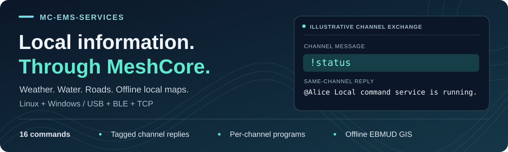

# MC-EMS-Services



[](RELEASE_v0.9.5-beta.md)
[](meshcore_mqtt_service/COMMAND_REFERENCE.md#command-index)
[](data/ebmud/README.md)

**Local information, delivered through MeshCore channels.**

MC-EMS-Services turns a MeshCore channel into a command-driven information service
for communities, field teams, and radio operators. Short channel messages retrieve
weather alerts, air quality, river stages, highway restrictions, and local trail
and recreation information. Replies return to the same channel with the sender's name.

**28 commands | Linux and Windows | USB, Bluetooth LE, or TCP | Offline GIS lookups**

**[Get started](#get-started)** | **[Try the commands](meshcore_mqtt_service/BOT_USER_GUIDE.md)** | [Installation](INSTALL.md) | [All documentation](docs/README.md)

## What it provides

| Highlight | Practical result | Commands |
| --- | --- | --- |
| 🌦️ **Weather and environmental conditions** | Current UV, PM2.5 air quality, heat alerts, and next-24-hour lightning potential. | `!uv`, `!aqi`, `!heatadv`, `!lightning` |
| 🌊 **Water and snow information** | River stages, active flood alerts, temporary flood monitoring, nearby snow depth, and forecast snowfall. | `!rivers`, `!floodwarn`, `!floodalarm`, `!snowpack` |
| 🛣️ **Highway restrictions** | Compact Caltrans reports for California route numbers. | `!traffic` |
| 🔥 **Wildfire information** | Interstate fire-weather zones, reported fires, containment, forecasts, alerts, context and temporary monitoring. | `!firezone`, `!fires`, `!fire`, `!firewx`, `!firewarn`, `!firedata`, `!firealarm`, `!smoke`, `!firedanger` |
| **California and Nevada landslide information** | Official alerts mentioning landslide hazards, temporary monitoring, and nearby USGS research stations. | `!slidewarn`, `!slidealarm`, `!slideinfo` |
| 🗺️ **Offline local maps** | Recorded trail policies, recreation amenities, peak elevations, park details, and mapped boundaries in the EBMUD area. | `!trail`, `!rec`, `!peak`, `!park`, `!boundary` |
| 🕒 **Service checks** | Responder availability and the configured local time. | `!status`, `!time` |

Multiple Public, hashtag, or private channels can have different command
assignments. Operators can add Python command programs after installation.
An optional MQTT interface supports integrations and controlled event export.
See [channel and program setup](meshcore_mqtt_service/MULTI_CHANNEL_GUIDE.md)
and the [MQTT interface](docs/ARCHITECTURE.md#mqtt-interface).

## From channel message to useful reply

```text
MeshCore channel --> Companion Node --> Linux or Windows service
                                              |
                                  Online source or local map data
                                              |
Same channel     <-- Companion Node <-- Tagged, concise reply
```

The companion connects to the service computer over USB serial, Bluetooth LE,
or TCP. One connection is active at a time. Internet access is needed by online
lookups; the five local GIS commands work without network access or API keys.

An illustrative exchange on the default `#autatestbot` channel:

```text
Alice: !status
Bot:   @Alice Local command service is running.

Alice: !trail Bear Creek dogs
Bot:   @Alice Bear Creek: dogs No.
```

Commands run only on assigned channels. Replies can arrive in several parts;
queued requests and radio transmission spacing can delay them. The
[quick user guide](meshcore_mqtt_service/BOT_USER_GUIDE.md) explains location
formats, flood-monitor renewal, GIS searches, and missing or shortened replies.

## Get started

### Essential requirements

- A Linux computer, Raspberry Pi ARM64, or Windows x64 computer and a reachable
  MeshCore Companion Node exposing the selected interface.
- Matching channel settings on the radio and service. The default is `#autatestbot`;
  configure the radio channel before starting the service.
- Internet access for online installation and external data lookups.
  Only `!aqi` requires an `AIRNOW_API_KEY`.
- For source-folder operation, Python 3.11 or newer and platform dependencies.
  OS service installers provision Python and dependencies automatically.

### Install and send the first command

1. Follow the [installation guide](INSTALL.md) for Windows x64, Linux x86_64,
   or Raspberry Pi ARM64. The distribution version is `v0.9.5-beta`.
2. Select USB serial, BLE, or TCP and configure the permitted channels and commands.
   USB serial autodetection is the default; attach one supported device or select
   an explicit port. Complete BLE pairing through the operating system first.
3. Start the service and send `!status` from another node on an assigned channel.
4. Try `!uv Sacramento`, `!traffic 80`, or `!trail Bear Creek dogs`.
   Use the [full command reference](meshcore_mqtt_service/COMMAND_REFERENCE.md#command-index)
   for all 28 commands and their response types.

For interactive source-folder operation, follow the
[Linux setup guide](meshcore_mqtt_service/README.md#linux-setup) or
[Windows setup guide](meshcore_mqtt_service_windows/README.md).
These launchers run while their console remains open; OS installers provide
unattended service operation. Restart after configuration changes.

## Coverage and important limits

- Bare city names default to California. Several commands accept US city/state,
  ZIP, or GPS input; air quality and river lookups require coordinates.
  Snowpack coverage is California-only, and highway reports cover California routes.
- Local GIS commands use EBMUD-area snapshots. They do not search every California
  park or establish current access permission, route accessibility, or live conditions.
  Standalone service ZIPs require `data/ebmud` separately; complete-workspace
  installers include it. See [GIS deployment](INSTALL.md#gis-source-deployment).
- `!floodalarm` checks for changes in flood-alert types approximately every 20 minutes
  and expires four hours after the last accepted subscription request. The service
  must remain running. `!floodwarn` performs one immediate lookup.
- Lightning output summarizes NWS forecasts and alerts; it is not a strike detector
  or a standalone official NWS lightning-warning product. Unavailable data does not
  mean conditions are clear. Reports supplement official emergency information.
- Local radio acceptance does not confirm remote reception. Software tests do not
  establish physical delivery, live four-hour monitoring, or target-device installation
  and reboot behavior. See [recorded validation](installers/VALIDATION.md).
- Installers are online installers; the Windows installer is unsigned. API keys,
  credentials, and private channel keys require protected local configuration.

## Explore further

| Goal | Guide |
| --- | --- |
| Send commands and interpret replies | [Quick user guide](meshcore_mqtt_service/BOT_USER_GUIDE.md) / [Detailed command reference](meshcore_mqtt_service/COMMAND_REFERENCE.md) |
| Install, upgrade, and configure channels | [Installation](INSTALL.md) / [Channel assignments and custom programs](meshcore_mqtt_service/MULTI_CHANNEL_GUIDE.md) |
| Operate a platform package | [Linux operation](meshcore_mqtt_service/README.md) / [Windows operation](meshcore_mqtt_service_windows/README.md) |
| Understand connections and integrations | [Architecture and MQTT](docs/ARCHITECTURE.md) |
| Maintain, test, or package the source | [Development guide](docs/DEVELOPMENT.md) |
| Load or maintain local map data | [EBMUD datasets](data/ebmud/README.md) / [California State Parks collection](data/california_state_parks/README.md) |
| Inspect statewide basin and beneficial-use reference data | [Basin Plan offline collection](data/basin_plans/README.md) / [Download datasets after cloning](docs/WATER_DATA_SETUP.md) |
| Review gauge links, downstream basins, and flood scenarios | [Offline Russian River flood-reference pilot](data/flood_impacts/README.md) / [Source citations](data/flood_impacts/SOURCES.md) |
| Inspect statewide USGS stations, current stage/discharge and downstream connections | [California current water data](data/usgs_water/README.md) / [Downstream and tributary relationships](data/usgs_water/ROUTING_METHODS.md) / [Source citations](data/usgs_water/SOURCES.md) |
| Use or maintain wildfire information | [Wildfire guide](meshcore_mqtt_service/WILDFIRE_GUIDE.md) / [Zone seed](data/wildfire/README.md) |
| Use the separate satellite catalog | [Satellite database tools](satellite_database/README.md) / [Stored catalog and exports](data/satellites/README.md) |
| Review changes and all documentation | [Release notes](RELEASE_NOTES.md) / [Version 0.9.5 - Beta highlights](RELEASE_v0.9.5-beta.md) / [Documentation index](docs/README.md) |

The California State Parks collection and satellite catalog are separate reference
resources; they are not registered MeshCore commands. Their guides describe data
coverage, provenance, refresh procedures, and interpretation limits.
