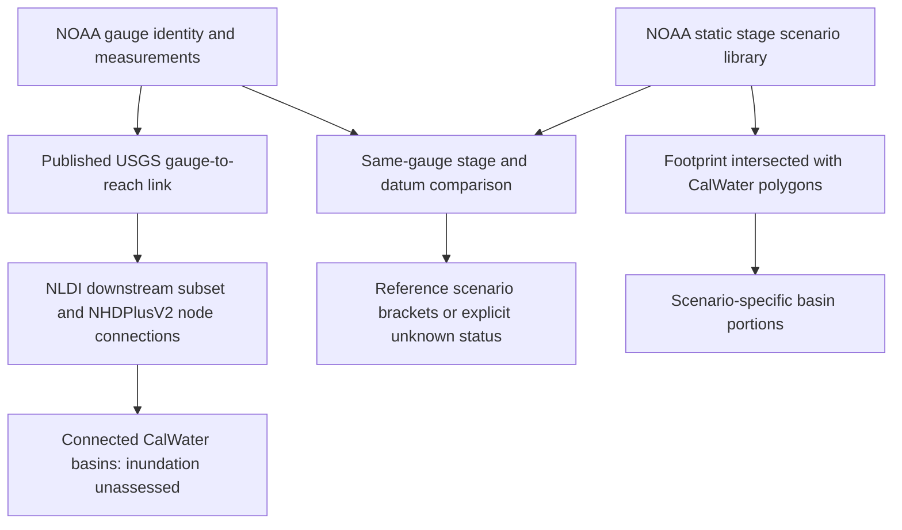

# Flood-reference methods and relationship tables

This bounded reference pipeline does not issue warnings or alter service scheduling.

## Acquisition and preservation

`archive.py` uses bounded GET requests: three attempts, 45-second timeout per
attempt. Each successful response is stored losslessly as gzip with its exact URL,
headers, retrieval time, compressed and uncompressed byte counts and SHA-256 hashes.
API errors and transfer-limit flags fail publication. ArcGIS exports enumerate all
IDs for the configured filter, query batches of 100, and require exact membership.
This detects incomplete exports; a changing service is not a transactional snapshot
and could still change attributes between requests.

`refresh.py` discovers all CatFIM polygon layers and exports every scenario returned
for the configured stations, including thresholds (`stage`) and intervals
(`interval_stage`). The separate site inventory selects `states LIKE '%CA%'`;
this may include gauges physically located in neighboring states and does not
claim complete California river monitoring coverage.

NLDI downstream-with-diversions (`DD`) requests specify an 80-km default limit.
Returned COMIDs select matching USGS WFS `wmadata:nhdflowline_network` records.
Every requested ID must be returned exactly once. WFS explicitly exports EPSG:4326.
Published attributes, including names and network fields, remain intact.

The Basin Plan reader verifies source hashes and full ID membership. A combined
scenario/network envelope selects candidate CalWater features; actual geometries
determine final intersections. Selected original features are copied into six
separate CalWater categories. The complete statewide originals remain untouched.

`manifest.json` records all file hashes, configuration, software versions, and the
pinned Basin Plan pointer. `build_code/` retains the build/query modules.
`dataset_provenance.csv` records source URL, region/plan labels, retrieval time, and
hash basis. Catalog generation time is distinct from source retrieval time.

## Relationship tables

These paths are relative to the generated region's `relationships/` directory.
Import identifiers as text. Source object IDs are scoped to dataset and generation.

| Table | Keys and interpretation |
| --- | --- |
| `gauge_reach_links.csv` | NWPS LID/USGS ID → NLDI COMID/reachcode. NWPS reach ID and WFS reachcode must agree; excessive point-to-reach distance requires review. |
| `flow_connections.csv` | `from_reach_id` → `to_reach_id` from published nonzero TONODE/FROMNODE. Branches remain separate. Blank downstream IDs carry terminal/boundary status. |
| `reach_calwater_overlaps.csv` | Reach → source-scoped CalWater feature, with name/code and intersection length in metres. Spatial membership, not flood impact. |
| `gauge_downstream_basins.csv` | Gauge → reachable reach → basin, with link/routing status. The starting reach is `same_gauge_reach` because its geometry can extend upstream of the station. |
| `inundation_scenarios.csv` | Scenario → gauge, stage/units, category, original field/layer/IDs, model versions, source URL, area. Static scenarios have no event valid time. |
| `scenario_basin_impacts.csv` | Scenario → basin portion, with affected area, complete basin area, fraction, and explicit derived-static evidence class. Depth is unavailable. |
| `basin_plan_reach_candidates.csv` | Network reachcode → regional ReachcodeTable row and `wb_refkey`. Join to existing Basin Plan hydrography relationships for waterbody members/names. Segment extent and vintage remain unverified. |
| `structure_connections.csv` | Reserved operator-inventory schema: structure, upstream/downstream reach, type, operator, state, validity, source URL, evidence. Empty in this pilot. |
| `dataset_provenance.csv` | Dataset/request → region, plan label, source URL, retrieval time, content hash and hash basis. |
| `coverage.csv` | Gauge map availability, published exclusion reason, scenario count, and missing structure/aqueduct/event assessments. |

The [Basin Plan tributary table](../basin_plans/RELATIONSHIPS.md) remains unchanged.
Parent-waterbody attribution is distinct from immediate hydraulic connectivity.
CalWater hierarchy describes nesting, not flow direction. Neither is converted
into invented downstream edges.

Traversal retains branches and uses visited IDs to terminate on cycles. Each
gauge's reachable set is compared with its NLDI navigation result; disagreement is
recorded. Agreement validates reference-network consistency, not current flow,
diversions, operator controls, or tidal reversal. The distance limit bounds the
acquisition and does not imply flood arrival time or map coverage.

## Spatial methods and readable names

Calculations use California Albers EPSG:3310. Fragments with the same
gauge/layer/stage/units/category/model versions are unioned before intersection.
Different scenarios are never combined into an event footprint. Shapely
`make_valid` repairs only derived projected copies, recording original/repaired
areas in `geometry_diagnostics.json`. Source bytes remain intact. Non-area repair
remnants and line/point-only contact create no affected-area row.

All six CalWater levels are calculated independently. Never sum their nested
areas, or add overlapping scenarios together. `scenario_basin_portions.geojson.gz`
contains actual intersection polygons, not entire watersheds or river buffers.
The fraction denominator is the full source basin polygon, not its pilot-envelope
portion. No extrapolation fills gaps outside a published footprint.

`waterways.geojson.gz` retains GNIS names and original network attributes. Basin
tables retain published names and codes. Region polygons omit names; a unique
archived hydrologic-unit HRC/HRNAME pair supplies the name where available, labeled
`basin_name_evidence=unique_hydrologic_unit_hrc_hrname`. Missing names remain explicit.
`calwater_review.geojson.gz` adds these review labels alongside original attributes.
Standard gzip tools can decompress GeoJSON before loading into a GIS viewer.

## Observation and forecast comparisons

Independent observation generations preserve complete NWPS responses and flattened
`measurements.csv`. Names, primary/secondary values, units, and times remain as
published; `kcfs` is not relabeled `cfs`. Raw records retain source quality
information; the collection does not independently validate the measurements.

`stage_scenario_links.csv` records comparisons at acquisition time. `report.py`
recomputes freshness using the observation generation's pinned static generation.
It does not mix new maps with older metadata automatically.

The latest non-future observation uses a six-hour default age limit. Forecast
review selects the highest future stage in the returned series and checks its
issue time against a 24-hour default limit. These configurable limits are review
rules, not agency guarantees. Primary measurements must be explicitly Stage/ft.
Station identity, service status, published datum name/zero, map availability, and
stage range must pass. No datum transformation, stage interpolation, rating-curve
conversion, hydrograph routing, or downstream stage extrapolation is performed.

Equal bounds identify an exact reference stage; unequal bounds identify two
reference scenarios. Multiple same-stage scenarios remain explicit IDs. Neither
case asserts current-event inundation. `--scenario` always selects a what-if
condition, including when observations are stale. Missing or empty coverage never
means that no flood can occur.

## Extension boundaries

The pilot validates acquisition, identifier matching, network consistency, and
spatial intersection. It has not been validated against a surveyed historical
flood extent. Other regions require reviewed station identities and source
coverage; use a separate configuration and output directory for each pilot.

Structures and aqueduct failures require cited, versioned operator records for
physical connections, operating state/effective time, receiving channels, and
applicable overtopping/breach simulations. Ingesting those inventories and hydraulic
models is future work; the empty relationship table is a schema, not a simulator.

Event inundation needs a compatible published forecast footprint or a calibrated
hydraulic model with terrain, controls, boundary conditions, and run validity.
Footprints may cross basin boundaries or extend upstream through backwater; do
not clip them to only downstream candidate basins. FEMA/DWR hazard layers, if
added, need their own static-hazard evidence class rather than an event label.

Asset exposure needs a cited roads/buildings/facilities inventory and separate
scenario-to-asset intersections. No asset inventory, depth grid, or travel-time
model was acquired for this pilot.
