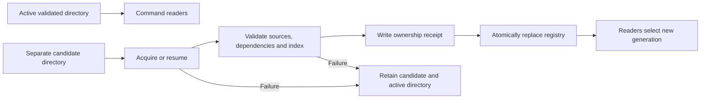

# Independent dataset installation and recovery

For graphical desktop installation and removal, use the
[desktop workflow](DESKTOP_INSTALLATION.md). Dataset and service installers
remain independent; the command examples below support maintenance and unattended
operation.

The [editable PyQt6 interface](DATASET_GUI.md) provides unified review and
execution over existing independent backends. Current capability-aware dataset
artifacts are required for coordinated maintenance. The original dataset-only
form remains available for independent maintenance.

[Installation](../INSTALL.md) | [Documentation index](README.md) | [Water acquisition details](WATER_DATA_SETUP.md)

Reference datasets have separate Windows x64, Linux x86_64 and Raspberry Pi
ARM64 installers. Each installs its own maintenance runtime and uninstaller;
the MeshCore service does not need to be installed first. Service installation,
upgrade and removal leave these datasets intact. No additional scheduler,
subscription or radio command is created.

## Select the required collections

| Package identifier | Contents and acquisition | Prerequisites |
| --- | --- | --- |
| `ebmud` | Twelve GIS layers, source manifests and preserved polygon-repair originals. Initial installation uses a supplied snapshot; update refreshes the documented EBMUD sources. | None |
| `basin_plans` | Full categorized Basin Plan archive, native originals and organized review generations, acquired online. | None |
| `flood_impacts` | Static Russian River flood-reference pilot and relationships, acquired online. This does not provide statewide flood modeling. | Basin Plans |
| `usgs_water` | Statewide inventory, latest observations, routing, review evidence and a matching spatial index, acquired online. | Matching Basin Plans and flood-reference generations |
| `wildfire` | Whole NWS fire-weather zone polygons. Initial installation uses a snapshot; update reacquires and validates zones. | None |
| `landslide` | Checksummed California/Nevada boundaries and reviewed monitoring stations. Updates use the curated snapshot supplied by a newer data installer. | None |
| `california_state_parks` | Optional complete GIS reference collection and original source files. Updates use the curated snapshot supplied by a newer installer. | None |
| `satellites` | Optional sourced satellite catalog, exports and orbital records, acquired online. | None |

Parks and satellite collections remain separate reference tools. Live alerts,
forecasts, fire incidents, AQI and other time-sensitive responses retain their
existing service-owned refresh and expiry rules. Reference installation does not
make those functions independent of their providers.

Data attribution, source terms and acquisition dates remain in each collection.
The project software license does not replace supplier terms. Curated Parks and
landslide updates do not scrape new content or infer unreviewed station facts.

## Install

Artifacts are built under `dist/v0.9.8-beta/datasets/`, with `SHA256SUMS.txt`:

```text
MeshCore-EMS-Data-<identifier>-v0.9.8-beta-windows-x64-setup.exe
MeshCore-EMS-Data-<identifier>-v0.9.8-beta-linux-x86_64.run
MeshCore-EMS-Data-<identifier>-v0.9.8-beta-raspberry-pi-arm64.run
```

Run the matching Windows EXE as administrator. Linux/Pi installation, for example:

```console
sudo bash MeshCore-EMS-Data-ebmud-v0.9.8-beta-linux-x86_64.run
```

Windows Installed Apps lists `MeshCore EMS Services` and independent
`MeshCore EMS Dataset - <name>` entries. Dataset names are EBMUD, Basin Plans,
Flood Reference, USGS Water, Wildfire, Landslide, California State Parks and
Satellites. Start menu shortcuts share the `MeshCore EMS` folder; each collection
appears under `Datasets/<name>` with Manage, Guide and Uninstall shortcuts.
Stable package identifiers and installation paths are unchanged during upgrades.

`Dataset.exe` is the PS2EXE-compiled maintenance entry point. Launching it without
arguments opens a console menu for status, verification, updates, rollback and
package removal. Right-click Manage and select **Run as administrator** for
updates or rollback. Status and verification can run without elevation when the
account has read access. Removal opens the package's executable uninstaller,
which requests elevation. Explicit action arguments support terminal automation
without a menu; the program returns the underlying operation's exit code.
The readable PowerShell source and private Python runtime remain in the payload.

These are online installers: even a bundled reference seed needs the private
maintenance dependencies provisioned. Windows downloads a checksum-pinned private
CPython runtime. Linux/Pi use Python 3.11–3.13 and a private virtual environment;
supported apt-based hosts provision Python/venv when needed. Data packages do not
reuse or remove the service interpreter. Reinstalling a selected valid collection
verifies it without downloading or downgrading it.

Windows setup reports exit code `20` if its dependency provisioning or dataset
preparation step fails; a completed file copy alone does not indicate a usable
dataset installation. Setup and the executable uninstaller retain per-run
`*.stdout.log`, `*.stderr.log` and `*.result.json` diagnostics beneath the package
tools directory's `logs` folder. The result file records the helper's exit code
and log paths. These logs remain available after removal. Direct `Dataset.exe`
maintenance commands continue to report their output in the calling terminal.

Rerunning the Windows EXE repairs the private maintenance runtime and verifies an
already selected collection. Runtime settings are replaced atomically, including
under Windows PowerShell 5.1; failed replacement preserves the previous settings.
Review the recorded error before retrying a failed installation.

Install the water packages in this order: Basin Plans, flood reference, USGS
Water. Prerequisites are checked explicitly rather than silently installing other
packages. The USGS package builds its spatial index before activation.

Default locations:

| Purpose | Windows | Linux/Pi |
| --- | --- | --- |
| Shared data root | `C:\ProgramData\MeshCore-EMS\data` | `/var/lib/meshcore-ems/data` |
| Per-package tools | `C:\Program Files\MeshCore-EMS-Data\<identifier>` | `/opt/meshcore-ems-data/<identifier>` |
| Activation registry | `datasets.json` beneath the data root | Same |
| Versioned files | `.datasets/<identifier>/<generation>/content` | Same |

A custom root can be supplied with Windows `/DATAROOT="D:\EMSData"` or Linux
`--root /srv/ems-data`. Set `MESHCORE_DATA_DIR` to the same root in the service
environment and standalone tool environment. The service account requires read
and directory traversal access. Data maintenance requires write access. Explicit
external GIS/water/satellite settings retain their authority; shipped defaults and
the persistent collection aliases use managed discovery.

Existing unmanaged directories are not deleted or rewritten. Initial installation
can import an existing collection into an isolated generation, validate it, and
leave the original directory in place. Registry absence retains source-checkout
behavior. An explicit uninstalled registry entry reports missing data instead of
silently restoring a bundled fallback.

## Update, inspect and roll back

From administrator PowerShell, for example:

```powershell
& 'C:\Program Files\MeshCore-EMS-Data\ebmud\Dataset.exe' status
& 'C:\Program Files\MeshCore-EMS-Data\ebmud\Dataset.exe' update
& 'C:\Program Files\MeshCore-EMS-Data\ebmud\Dataset.exe' verify
& 'C:\Program Files\MeshCore-EMS-Data\ebmud\Dataset.exe' rollback
```

Equivalent Linux/Pi commands:

```console
sudo /opt/meshcore-ems-data/ebmud/dataset status
sudo /opt/meshcore-ems-data/ebmud/dataset update
sudo /opt/meshcore-ems-data/ebmud/dataset verify
sudo /opt/meshcore-ems-data/ebmud/dataset rollback
```

For curated datasets, install the newer data-package tools first, then run
`update` to stage the newly supplied seed. Existing data is not reset by setup.
Satellite refresh through the original catalog CLI is rejected for managed
generations; use the satellite data-package updater. Read-only catalog commands
resolve the active snapshot, and summary displays its recorded coverage report.

Every update follows this sequence:



Source errors, unexpected empty responses, truncated downloads, checksum failures,
insufficient disk space and registry replacement failures leave the previous
active directory and registry selection unchanged. Acquisition never clears the
active directory first. All validation precedes the atomic activation write.
Readers pin a generation for their operation; previous directories remain available
for in-flight readers and rollback. No automatic garbage collection runs.

Receipts record installed file hashes, acquisition package identity and exact
dependency generations. Updating Basin Plans does not retarget an existing USGS
collection. Update flood reference against the selected Basin Plans before updating
USGS Water. Incompatible dependencies are rejected; the previously usable water
collection and its index remain selected. Dependency and rollback references also
block unsafe prerequisite removal.

`status` separates active selection from the last attempted update. A failed update
does not refresh the original acquisition timestamps. Retained reference data can
continue serving lookups; expired warnings or old readings are never made current
by retention. Existing freshness limits continue to apply.

## Interrupted acquisition and storage

Failed candidates remain unpublished. Their 32-character candidate identifier is
reported by `status`. Resume with unchanged dependencies and the same action:

```powershell
& 'C:\Program Files\MeshCore-EMS-Data\usgs_water\Dataset.exe' update -Resume <candidate-id>
```

```console
sudo /opt/meshcore-ems-data/usgs_water/dataset update --resume <candidate-id>
```

Basin Plan acquisition resumes its pending snapshot; USGS acquisition checkpoints
completed phases and resumes supported pending stages. Other acquisition steps can
retry in the isolated candidate. A changed prerequisite selection requires a new
candidate. Pending content is never considered a usable installation.
Resuming also requires the same installer payload identity; a newer maintenance
release must start a new candidate. Mutable legacy prerequisites must be imported
with their own installer before dependent collections can pin them.

Allow space for the active collection, new candidate and retained rollback versions.
The known local-copy estimate is checked before acquisition; provider output size
is not assumed to be bounded by that estimate. Disk exhaustion still leaves active
data unchanged. A hard process termination may leave `.datasets.lock`. Current
locks carry process-creation and participant evidence. Use the desktop
**Recover a reviewed interrupted dataset operation** action after inspecting
Recovery history; it archives a verified orphan lock and preserves the registry
and datasets. Live or unknown processes block recovery. A PID or old timestamp
alone does not establish that removal is safe. Legacy locks require administrator
investigation. See [ownership and recovery](UNIFIED_INSTALLER.md#failure-and-retention).

Failed candidates and older versions are deliberately retained. There is no
automatic age-based cleanup. Manual cleanup requires inspection of active/previous
registry records and all dependency receipts; deleting a referenced generation
breaks its consumers.

## Uninstall

Stop consumers of the collection before intentional removal. On Windows use the
collection's Installed Apps entry, which runs its own `unins*.exe`. It is independent
of the main service uninstaller. Linux/Pi:

```console
sudo /opt/meshcore-ems-data/ebmud/uninstall
```

The desktop action **Uninstall selected maintenance packages; retain datasets**
removes only the maintenance package and preserves every dataset file and registry
selection. Reinstall matching tools before further maintenance.

Default native removal deselects the collection and removes receipt-owned, unmodified
generations. Modified directories, unowned files, legacy directories and incomplete
candidates without receipts are retained and reported. Active or rollback
dependencies prevent removal. Remove dependent water packages in reverse order.

Windows unattended removal with `/VERYSILENT /SUPPRESSMSGBOXES` returns a nonzero
exit code when dependency checks or dataset removal fail, without waiting for an
error-dialog response. The dataset and maintenance tools remain in place; inspect
the package's `logs` folder before retrying.

Explicit Linux `uninstall --purge`, Windows uninstaller `/PURGE=1`, or the maintenance
command `uninstall -Purge` also permits deletion of modified receipt-owned content.
Purge does not bypass dependency checks, delete arbitrary legacy directories or
remove failed candidates without ownership receipts. The maintenance `uninstall`
action removes data selection/content only; the OS uninstaller also removes that
package's tools. Removing the service never removes these data packages.

## Build and validation

```console
python tools/build_data_installers.py
python -m unittest discover -s tools -p test_dataset_manager.py
python -m unittest discover -s tools -p test_dataset_adapters.py
python -m unittest discover -s tools -p test_data_installers.py
```

The builder requires Inno Setup and PS2EXE 1.0.18 for Windows;
the [build guide](../installers/datasets/BUILD.md) describes compiler setup.
`--linux-only` emits the two distinct
Linux/Pi artifacts. `--dataset <identifier>` selects a collection. Data packages
can be released independently with `--version vMAJOR.MINOR.PATCH[-suffix]`.
Optional `--sign-tool NAME=COMMAND` enables signing of Windows installers and
uninstallers with a configured certificate; default builds are unsigned. Source inventories
exclude downloaded water archives, credentials, development environments and local
service state. Maintained snapshot bytes are preserved. Native data terms remain
with the references. Dataset builds do not acquire live data or install OS services.

Failure-injection tests cover outage, partial/empty content, disk errors, activation
failure, resume, rollback, dependency removal and operator-file preservation.
Paired service tests cover discovery and consistent reads. Native Windows and
Ubuntu 24.04 under WSL lifecycle checks passed for all eight collections, including
failed updates, service-account reads and removal. The
[validation record](../installers/VALIDATION.md) describes the evidence and limits. A Raspberry Pi
test device is unavailable; ARM64 package and dependency checks do not establish
native Raspberry Pi operation. Automated tests and WSL execution do not establish
reboot behavior, current provider availability or physical radio delivery.
