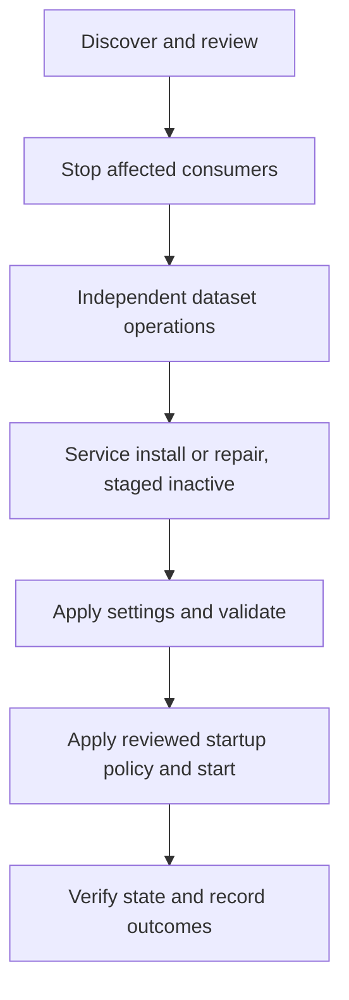

# Unified interface ownership and recovery

The PyQt6 interface coordinates independently owned packages. Python runtimes,
identities, deployment units and update lifecycles remain separate.
The [desktop guide](DESKTOP_INSTALLATION.md) contains the graphical workflow.

## Ownership

| Component | Lifecycle owner | Removal retention |
| --- | --- | --- |
| Bridge, responder, bundled broker and shipped command applications | Existing service installer and uninstaller | Settings, credentials, custom programs, runtime databases, subscriptions and backups |
| Each reference collection | Independent dataset installer, runtime and data registry | Active and previous generations remain when only tools are removed |
| Custom program registration | Service configuration and integration receipt | Deregistration retains copied source |
| Local transport, channels, MQTT and data-root bindings | Protected service configuration | Deconfiguration preserves external edits and credentials |
| External brokers, OS dependencies and device configuration | External owner | Retained; no administration, flashing, reset or channel writes |

Full removal uninstalls the stopped service before selected dataset packages.
Dataset installation expands `basin_plans → flood_impacts → usgs_water`; removal
reverses dependencies and blocks unselected active or rollback dependents. State
Parks and satellite references remain optional. Core service installation does
not require all reference datasets.

## Review and coordination

`installers/desktop/unified_backend.py` constructs the shared plan. Native workers
reconstruct it and compare its fingerprint under a protected maintenance lease.
Package records, artifact checksums, configuration and credential revisions,
service state and startup policy bind the review. Existing backends remain
responsible for validation and postconditions. Journals record recovery evidence,
not package ownership, settings or credentials.

New native wrappers and workers share a process-creation-bound lease. Legacy
tools cannot be made cooperative by a GUI-only lock. Current-artifact repair is
required before invoking them in coordinated mutations. Dataset capabilities are
`maintenance-lock-v1` and `retain-data-v1`; service capabilities are
`operation-lock-v1`, `settings-v2` and `staged-startup-v1`. Missing capabilities
produce blockers rather than assumed support.

Windows installed-code execution also requires protected owners and ACLs for
code and its ancestors. Held native handles prevent replacement races. Unsafe
custom locations are blocked with graphical native-repair guidance; unrelated
directory permissions are not weakened. Staged artifacts and settings use
private machine-owned storage rather than caller-controlled temporary ancestors.
The checks use the native [Windows file-security API](https://learn.microsoft.com/en-us/windows/win32/fileio/file-security-and-access-rights).

## Integrations

USB autodetection and a bundled localhost broker are defaults. TCP and BLE select
pre-existing companion endpoints; pairing remains an OS operation. Private
channels reference named credentials. Graphical channel and application tables
edit local references and export policy, never device slots. Companion checks use
only the existing read-only channel check while the service is stopped. Offline
validation does not open a device. Neither check establishes radio delivery.

The typed `dataset_root` setting selects a stable registry root. Service runners
and the installed satellite launcher propagate it to consumers. Explicit external
data paths remain authoritative. Roots must be accessible to the service account;
arbitrary parent-directory permissions are not weakened automatically.

Shipped programs remain service-package files. Disabling a command removes local
assignments while retaining them in the receipt for re-enabling. Imported custom
programs receive dedicated hash-bound source files in the existing protected
programs directory. Static parsing never imports or executes them. Dependencies
are not installed automatically. Scheduling and subscription creation, eligibility
and expiry remain service-owned.

## Failure and retention

Native dataset mutation requires a protected root and ancestor chain throughout
the operation. Caller-writable custom parents are rejected with graphical
selection guidance. The Linux service state parent is installer-owned; only its
runtime child remains service-writable, preventing service programs from replacing
the dataset sibling during privileged maintenance. Retained custom roots are
rediscovered through verified advisory hints and native package records; a root
choice does not migrate data or change service configuration automatically.

Cancellation applies between safe owner operations. Native installation,
configuration publication and dataset activation do not form one atomic
transaction. Completed steps remain after failure; subsequent startup is withheld.
Refresh discovers actual state before a new review or explicit repair.

Persistent journals use protected maintenance storage independent of package and
service-account directories. Recovery history requires native authorization.
**Recover interrupted maintenance** inspects the owner, delegated participants
and native process evidence before releasing a reviewed orphan. Evidence is
archived. Live or unknown processes block recovery; legacy leases require
administrator investigation. Recovery never kills maintenance processes.

Current dataset registry locks have a separate owner-backed reviewed recovery
operation. It verifies process creation and inherited native-process evidence,
archives the lock and preserves data and registry contents. Historical locks
without those ownership records remain blocked rather than inferred safe from
their age or PID alone.

Backups and dataset previous generations support owner-specific recovery.
Deconfiguration compares recorded after-values before restoring originals;
conflicting and ownership-unknown settings remain. Credentials, source files,
databases, subscriptions and recovery material are retained. Retaining a database
does not guarantee subscription eligibility after channel changes. Purge is not
offered by the unified interface.

## Qualification

Offline and offscreen tests establish only their tested planning, preservation
and UI paths. WSL, Xvfb and QEMU ARM64 do not establish native desktop authorization,
reboot behavior, clean-system lifecycle, physical Pi performance, USB/BLE access
or radio integration. Distribution verification reports identify actual run
results and artifacts. Older reports do not qualify changed binaries.
