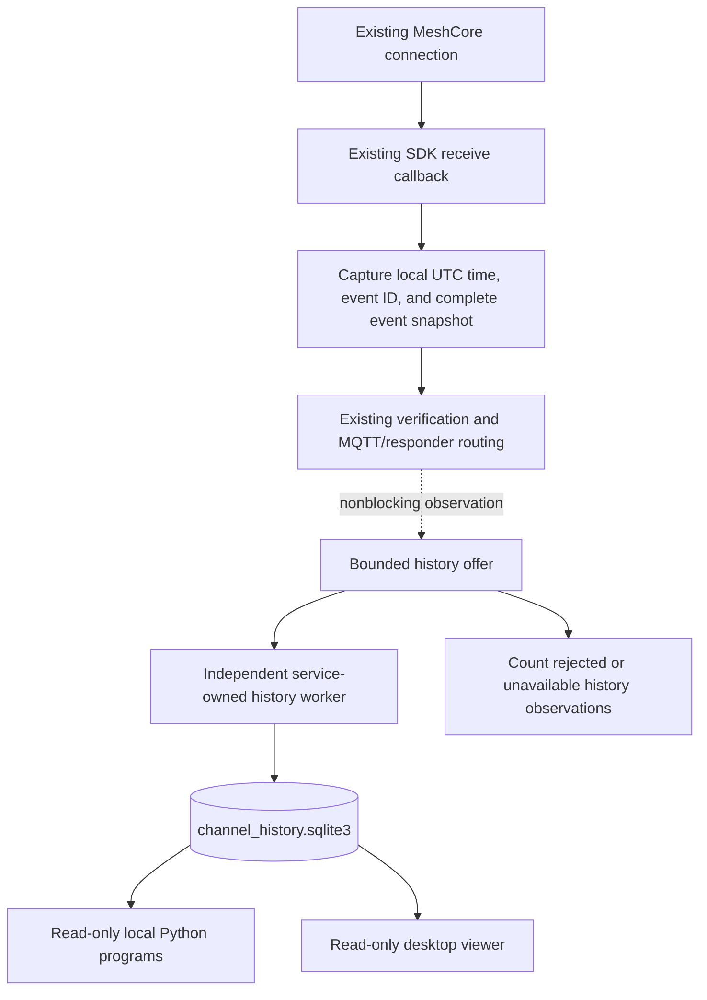

# Configurable channel message history

Status: implemented in the working tree; native deployment acceptance remains
unverified. See the [implementation verification](../../CHANNEL_HISTORY_VERIFICATION.md)
and [operational guide](../../../meshcore_mqtt_service/CHANNEL_HISTORY.md).
Inspection baseline: `4381fd444d786db8490fd2ad20eef2b648ee9155`, October 28, 2026.

## Outcome and scope

Record identifiable messages received by the running service on one selected
MeshCore channel. Expose a rolling 24-hour history to other local Python programs
and a read-only desktop viewer. Include recording controls in the installer GUI
for Windows x64, Linux x86_64, and Raspberry Pi ARM64.
The initial target is `#falldetect`; configuration can select another public,
hashtag, private, or already configured channel. Direct/contact messages are
excluded, regardless of their text or sender.

Recording performs no command recognition, fall detection, alerting, body parsing,
content filtering, or automatic reply. Existing command execution, scheduling,
subscriptions, transport ownership, and MQTT export rules remain in the service.
No additional OS service, MeshCore command, MQTT consumer, firmware target, or external
database server is introduced. The design contract below describes implementation
boundaries; test evidence is separate from native deployment and hardware evidence.

GUI configuration and read-only browsing are part of this design's scope.
Recording continues with all GUI windows closed. The service owns the writer and
expiration; the desktop interfaces own configuration and presentation only.

Existing programs, service routing, scheduling, and installer operations take
priority over optional recording. Under healthy storage and within the bounded
resource budget, record every identifiable selected-channel message without
content filtering. Under overload or recording failure, preserve primary
operation and explicitly account for history gaps. Queue admission is not a
durability acknowledgement. No lossless-overload guarantee is made.

The isolation contract forbids waits for recorder capacity, identity lookups,
database commits, retries, initialization, or shutdown in primary execution paths.
Optional history errors never change a primary result or service exit code.
This is control-flow and failure isolation with bounded resource use, not a claim
of zero CPU/disk overhead or immunity to host-wide hardware/OS failure.

## Existing behavior established from source

Paths below are relative to the repository root. The receive implementation is
equivalent in both platform packages; the service files differ in port support
and associated help text.

| Source | Existing behavior relevant to the design |
| --- | --- |
| `meshcore_mqtt_service/service.py:207` | `bridge_loop()` resolves registered channels, opens the outbox, and owns the radio callback and responder workers. |
| `meshcore_mqtt_service/service.py:341` | `process_event()` creates a UUID/UTC envelope, resolves the received slot, verifies channel identity, applies MQTT export policy, then calls `Responder.accept()`. |
| `meshcore_mqtt_service/service.py:373` | One `mc.subscribe(None, receive)` receives SDK events; `start_auto_message_fetching()` drains the companion's pending messages. |
| `meshcore_mqtt_service/service.py:75` | `Store` uses SQLite/WAL for an MQTT outbox; `ack()` deletes published rows. This is not a recent-message archive. |
| `meshcore_mqtt_service/responder.py:198` | Command parsing excludes noncommands, stale timestamps, self/reply text, and unsupported message types. Command deduplication is based on content and sender timestamp. These rules must not govern history. |
| `meshcore_mqtt_service/channels.py:176` | Channel resolution verifies name, optional slot, and key. `verify_binding()` checks name and key again; `bind_state()` pins identity across restarts. |
| `meshcore_mqtt_service/config.json:350` | The shipped registry contains `default` / `#autatestbot`; it does not yet register `#falldetect`. |
| `meshcore_mqtt_service/service_runner.py:116` | Installed services supply the runtime directory through `--state-dir`; it is not always the source package's `runtime/` directory. |
| `tools/package_services.py:15` | Standalone ZIPs use explicit root-file inventories and compare selected shared files. A new root module must be added to both inventories and parity checks. |
| `installers/desktop/unified_window.py:173` | The unified installer already has a Channels / applications page and a Review / Execute workflow. |
| `installers/desktop/service_window.py:71` | Standalone Service Setup has an advanced registry editor and existing private-channel credential controls. |
| `installers/desktop/service_backend.py:42` | GUI settings pass a bounded allowlist, installed validation, backup, and configuration application; `channel_history` is not currently accepted. |
| `installers/desktop/service_backend.py:557` | Candidate validation checks the complete shared credential mapping before core channel keys. Optional credential edits need separation before entering this mandatory path. |
| `installers/desktop/authorization.py:290` | A separate authorized worker performs structured requests without elevating the Qt UI; current dispatch supports dataset, service, and unified operations. |
| `installers/desktop/service_window.py:271`; `unified_window.py:568` | Desktop close waits for its existing maintenance task. A history read must not become that task or add a required QThread join. |
| `installers/datasets/gui/main.py:52` | The primary desktop launcher opens unified maintenance by default; `--datasets-only` opens the independent Dataset Manager. |
| `tools/build_installers.py:108` | Installed capability metadata advertises supported maintenance contracts; history support requires a new capability. |
| `installers/configure.py:59` | Mandatory configuration backups scan root-level `runtime/*.sqlite3`; optional history must not become another required backup dependency. |

The installed package virtual environment contains the required MeshCore 2.3.11.
Its `meshcore/reader.py:276-349` constructs `CHANNEL_MSG_RECV` payloads containing
`channel_idx`, `txt_type`, `sender_timestamp`, and decoded `text`, with optional
path, RSSI, SNR, receive time, attempt, and `txt_hash` metadata. These paths do not
provide a distinct sender identity or reliable unique message ID. `txt_hash` is
a short content/timestamp hash, not proof of a separate transmission. The SDK
decodes UTF-8 with errors ignored and one variant strips NUL bytes. The proposed
recorder can preserve the complete delivered event, not bytes already discarded
by the SDK. No SDK modification is proposed.

`docs/ARCHITECTURE.md:34` currently describes responder delivery through MQTT;
the source shows direct SDK delivery. An implementation-time documentation update
should correct that sentence while explaining the history branch.

## Approaches and recommendation

| Approach | Assessment |
| --- | --- |
| Separate SQLite file, written by the existing service | Recommended. Provides transactional inserts, indexed time queries, and separate read connections without sharing command/subscription tables. |
| History table in `bridge.sqlite3` | Possible, but couples external readers and retention work to operational service state and its write contention. |
| Rotating JSON-lines files | Simple append format, but consistent concurrent reads, exact rolling expiration, and indexed queries need additional file-management logic. |

SQLite is already used by the project. Python's `sqlite3` API supplies file-based
storage without another server. [Python sqlite3 documentation](https://docs.python.org/3/library/sqlite3.html).
WAL permits concurrent readers and a writer on the same host; it is unsuitable
for a shared network filesystem. [SQLite WAL documentation](https://www.sqlite.org/wal.html).

## Channel selection

Add a top-level service configuration section. A channel used only for recording
has its own reference outside the required service registry:

```json
{
  "channel_history": {
    "enabled": true,
    "channel_id": "fall_events",
    "channel": {
      "name": "#falldetect",
      "type": "hashtag",
      "mqtt_export": false
    }
  }
}
```

`channel_id` remains the stable history identity. If `channel` is absent or null,
it references an already-required `responder.channels` entry. If `channel` is
provided, it is an optional recording-only reference with the same name/type/
slot/secret-reference syntax; its ID must not collide with a core registry ID.
Its `mqtt_export` value must be false and has no routing effect. Do not merge it
into `responder.channels`, create a bot for it, or pass it to core `bind_state()`.
The existing service registry and its validation retain their current semantics.

The following entries illustrate alternative channel specifications. For an
existing required service channel, select its registry ID with `channel: null`.
For a recording-only channel, put the selected specification under
`channel_history.channel`; do not add it to the service registry:

```json
{
  "fall_events": {
    "name": "#falldetect",
    "type": "hashtag",
    "mqtt_export": false
  },
  "community": {
    "name": "Public",
    "type": "public",
    "mqtt_export": false
  },
  "private_events": {
    "name": "Fall Events",
    "type": "private",
    "secret_env": "MESHCORE_CHANNEL_KEY_FALL_EVENTS",
    "mqtt_export": false
  }
}
```

Select `private_events` or `community` using the corresponding stable ID and
specification, or select an existing service ID with `channel: null`.
Another named hashtag channel uses `type: "hashtag"` with its exact name. A
private channel may also have a name beginning with `#`; use `type: "private"`
when it uses a custom key. `type: "existing"` can adopt and pin an already
configured channel when its key mode is not specified. The example assumes
`#falldetect` uses the standard hashtag-derived key; deployed key mode has not
been inspected. Credentials remain in the existing restricted environment-file
mechanism, never in the log or ordinary configuration.

Validate history settings separately, even with `responder.enabled=false`.
Invalid history syntax, missing optional credentials, absent/ambiguous channels,
or wrong keys disable/degrade the recorder only. Existing required service
channel failures retain their original handling; do not weaken that validation.
An explicit attempt to save invalid history settings is rejected for the history
portion of the operation, under the installer isolation contract below.

Resolve recording identity from name/key evidence already obtained by the core
service, never by text or slot alone. Expose a sanitized copy of the complete
slot snapshot from the existing discovery through an optional, exception-contained
observer on `resolve_channels()`; do not add discovery queries or change its
existing returned bindings. Observe subsequent existing CHANNEL_INFO events in
the same way. Observations contain index, name, key fingerprint, and observed UTC
time, not key bytes. The core hook emits plain immutable standard-library data;
`channels.py` must never import or require the optional history module. Adapt
that data to history-specific types inside the guarded optional boundary.
For core target messages, reuse their existing per-message
verification result. Recording-only targets use the passive snapshot, with its
source/time explicitly stored. No recorder task acquires the radio command lock,
calls `get_channel`, wraps/gates `get_msg`, or starts a second fetch loop.

If the original service configuration does not perform discovery and no usable
channel-info observation exists, recording remains unverified until evidence is
available. The recorder does not add radio operations to solve that gap. Radio
configuration must remain stable between observations; changed/unverifiable
identity suspends recording instead of inventing a verified attribution. Optional
slot selection may disambiguate names, but never substitutes for key evidence.
Provisioning remains an explicit separate radio operation; recording never
programs slots or changes firmware.

Configuration changes take effect on restart. A new channel uses its own stable
ID. The history worker pins optional identities in its own `history_bindings`
table; changing one under its old ID suspends only recording. Core registry pins
remain unchanged. Previous records retain their original ID, name, slot, and
identity and expire normally. Read calls require an explicit channel ID, so a
target switch cannot silently mix records. All retained channels share the same
database access boundary; per-channel credentials or access isolation are not
provided by this local API.

Record only `CHANNEL_MSG_RECV`. In particular, ignore `CONTACT_MSG_RECV`, raw
packet logs, transmit acknowledgements, and `BOT_REPLY`. A channel packet sent
over a direct radio path remains a channel message; event type, not `path_len`,
distinguishes it from a contact/direct message. Do not assign command programs
to a channel merely because recording is enabled. `mqtt_export=false` must not
disable local recording.

For backward compatibility, absent configuration means disabled. Shipped
defaults should show `enabled: false`, `channel_id: null`, and `channel: null`;
deployment enables the feature after the radio channel is available. Disabled
configuration does not require a target. This prevents an upgrade from requiring
an unconfigured channel or silently selecting a private channel for logging.

## Receive integration and service lifecycle



1. Keep core startup validation, required channel resolution, fetch startup, and
   existing radio command serialization unchanged. Load history support lazily
   inside an optional-feature error boundary. Missing modules, invalid history
   configuration, missing optional keys, or worker-start failure select a no-op
   recorder with an unavailable status; they never abort the bridge or change
   the normal `--check` exit code. Core configuration errors still fail normally.
   Absent/disabled history selects the no-op without importing its optional
   module, creating a directory, or starting a worker.
2. Reuse the envelope's UUID/local UTC reception timestamp captured at callback
   entry. Perform existing identity checks, MQTT publication decisions, and
   `Responder.accept()` independently of history. In a contained final observation
   step, call synchronous `offer_received()` with the complete envelope and
   existing identity outcome. It must also observe noncommands and events
   suppressed by MQTT policy. A core identity failure cannot be overridden by
   a passive history binding; record an unverified-gap count instead.
3. `offer_received()` makes a bounded, detached snapshot and attempts immediate
   queue admission. It performs no disk/radio I/O, logging-handler call, await,
   future wait, task creation, or blocking capacity acquisition. The bridge
   catches any optional snapshot/offer exception without replacing the original
   routing result or exception. Do not reuse responder parsing or content hashes.
   Shared admission/state locks must use try-acquire and reject/count contention;
   a queue's capacity-only `put_nowait()` is insufficient if its internal mutex
   can block. The worker never holds such a lock during I/O or diagnostics.
   Status reads use a last-published immutable snapshot; producer-owned rejection
   counters must not depend on a stalled worker releasing a lock.
4. A dedicated daemon `threading.Thread` owns its SQLite connection, initialization,
   optional binding resolution/pins, writes, retention, and retry. Do not use a
   ThreadPoolExecutor or non-daemon thread that is joined at interpreter exit.
   No bridge database connection or radio lock is shared with the worker. Core
   startup proceeds immediately; initial records may queue while the worker
   initializes, within the same fixed budgets as normal operation.
5. Bound pending plus in-flight history work to 1,024 records and 16 MiB. Bound
   each detached snapshot to 64 KiB using a bounded traversal/copy; reject a
   larger snapshot intact and count it, never truncate text or metadata. On
   saturation, reject the incoming history observation immediately (drop-newest),
   preserve existing queued records, and increment reason-specific gap counters.
   Never pause shared fetching or make selected/unrelated command work wait.
   Degraded/unverified/stopping recorders likewise return immediately. No extra
   tasks, queues, retransmission requests, or disk spools bypass these budgets.
6. Worker-side storage failures fail only pending history jobs and update local
   state; they do not propagate into service supervision. Retry busy writes using
   the same event ID within 5 seconds, entirely off the event loop. Retry storage
   initialization/recovery at most once every 60 seconds, without adding workers.
   A hung worker is not joined or replaced by another accumulating worker. Its
   full queue causes counted rejections while primary operation continues.
7. Track offered, admitted, committed, pending, and missed counts plus first/last
   affected UTC times by bounded reason category. Use fixed counters, not an
   unbounded list of event IDs or messages. Worker-side diagnostics are
   rate-limited to one summary per 60 seconds and never run on the receive or
   installer thread. Any diagnostic sink is history-only, bounded within the
   history storage budget, and independent of primary logging handlers, output
   streams, and locks. A stalled diagnostic write must not hold a lock used by
   existing service logging. Gap reporting itself must not block primary work. Logs and
   in-memory counters are best effort under full disk/hard crash; no persistent
   complete audit is promised when its storage is unavailable.
8. At the existing stopping cutoff, call `stop_nowait()` and retain the core's
   original callback cancellation/disconnect sequence. Do not wait for history
   initialization, queued work, locks, verification, commits, retries, or thread
   exit; no additional shutdown/drain deadline is introduced. The daemon may
   finish an in-progress transaction while normal cleanup proceeds, then closes
   its own connection when runnable. Queued/uncommitted work at exit is explicitly
   incomplete, even on a graceful service restart. No flush success is claimed.
   Existing service-manager stop/restart deadlines and ownership are unchanged.

The recorder never initiates identity queries. Known changed or missing identity
disables its own target until valid passive evidence and existing history pins
agree (a changed pinned identity requires a new history ID). Other channels'
verification behavior is untouched. Store `binding_source` and
`binding_observed_at` so snapshot attribution is not presented as per-message
verification. Configuration changes between observations cannot be reconstructed
from slot-only events; this limitation is preferable to adding recorder-induced
radio-lock waits or weakening core identity checks.

## Storage and retention contract

Use `service.RUNTIME / "channel_history" / "channel_history.sqlite3"`. This resolves to the package
runtime for manual use, or the installed `--state-dir` for services. Typical
installed locations are `/var/lib/meshcore-ems/runtime` and
`C:\ProgramData\MeshCore-EMS\runtime`. Readers receive an explicit absolute path;
they must not guess from the current working directory.

The dedicated subdirectory keeps history out of the existing mandatory
`runtime/*.sqlite3` configuration-backup scan. Retain the existing backup behavior
for bridge, subscription, and other operational databases. No installer/repair/
deconfiguration/uninstall step may open, validate, migrate, checkpoint, or back
up the history database as a prerequisite. History files remain in place under
the existing retain-data policy; they are not copied into configuration receipts
or automatic recovery backups. This is a new feature, so there is no implemented
legacy history location to migrate.

Schema version 1 uses `PRAGMA user_version` and a `channel_messages` table:

| Column | Meaning |
| --- | --- |
| `event_id TEXT PRIMARY KEY` | Locally generated reception/envelope UUID; not an upstream message ID. |
| `received_at_us INTEGER NOT NULL` | Local UTC reception time, integer Unix microseconds. |
| `channel_id`, `channel_name`, `channel_identity` | Stable registry ID, exact name, and existing nonsecret identity fingerprint at receipt. |
| `channel_index INTEGER NOT NULL` | Actual companion slot at receipt. |
| `binding_source`, `binding_observed_at_us` | Existing per-message check or passive slot snapshot, with the time of that evidence. |
| `text TEXT NULL` | Exact decoded SDK text, including whitespace, Unicode, delimiters, and NUL characters when present. |
| `sender TEXT NULL` | Only a documented structured sender field supplied by the source; normally absent in current channel events. |
| `source_message_id_json TEXT NULL` | Source message identifier and type when actually available; normally absent with SDK 2.3.11. |
| `sender_timestamp INTEGER NULL` | Original SDK sender timestamp when present as an integer; never a retention clock. |
| `payload_json`, `attributes_json`, `device_json` | Complete normalized event payload, attributes, and available connection metadata. Unknown fields remain here. |

Do not trim or split `text` or derive a sender identity from `Name: message`.
Unavailable metadata stays NULL. Preserve nonconforming/unknown fields in the
JSON even if they cannot populate an indexed column. Use the existing envelope
representation for binary fields (`encoding: hex`), enums, and secret metadata
redaction. Redaction must not inspect or rewrite message-body strings. Do not
persist channel keys or unrelated channel-info events.

Create indexes on `received_at_us`, `(channel_id, received_at_us, event_id)`, and
`(channel_id, sender, received_at_us)`. Use parameterized SQL and short explicit
transactions. Set WAL, `synchronous=FULL`, and a 1-second busy timeout on the
writer. One writer owns inserts, deletion, and checkpoints; readers use separate
connections. The commit boundary is the durable-record acknowledgement.

Queue admission is separate from that commit boundary. Enforce resource guards
inside the worker: a 256 MiB history-storage budget including WAL/sidecars, a
512 MiB free-space reserve on the containing filesystem, batches of at most 32
records, and a yield between batches. Check space and projected bounded batch
growth before writes; configure a main-database page cap and stop admission near
the total budget rather than permitting unbounded WAL growth. If a safe write
cannot be established, enter resource-limited state and report gaps. Do not
delete unexpired history or unrelated files to make room. Cleanup/checkpointing
also obey resource limits and may defer while unsafe; reads still exclude
expired rows. These guards reduce contention and self-induced disk exhaustion;
external writers and host-wide disk failures cannot be prevented by this module.

Retention is fixed at 86,400 seconds. For each read, sample local UTC once and
return only `now - 24 hours < received_at <= now`. A record exactly 24 hours old
is expired. Optional `start` is inclusive and `end` is exclusive, and both are
intersected with that current window. A caller cannot retrieve expired rows by
requesting an old date range. Reject naive datetimes; normalize aware inputs to
UTC. Order by reception time, then event ID for deterministic ties.

The writer deletes rows with `received_at <= now - 24 hours` at startup and at
least every 60 seconds while the worker is healthy and writable, even with no new messages. Check the
maintenance deadline between batches so sustained traffic cannot starve cleanup.
Read-time filtering enforces the exact window between sweeps. Sweep all channel
IDs, including previously selected channels. No midnight reset or sender-clock
expiration is used.

While the service is stopped, no timer can physically delete records. Readers
still hide expired rows and the next writer initialization prunes before its own
first insert; core message fetching never waits for that cleanup.
Deletion is logical record retention, not secure byte erasure: database free
pages, WAL content, existing backups, or consumer copies may retain bytes. Avoid
per-message VACUUM; allow normal checkpoints and page reuse. Clock corrections
affect a wall-clock window; preserve recorded receipt times, exclude future-dated
rows after a backward correction, and report a detected clock discontinuity.
Deleted records cannot be restored if the clock subsequently moves backward.

## Duplicate handling and completeness limits

The same envelope submitted again with the same `event_id` and unchanged data is
an idempotent retry: the worker records no additional row and does not update
its reception time or extend retention. Admission may report `queued` before
that decision; worker accounting distinguishes an already-committed retry from
a new commit. The same ID with different data is a history-only consistency
error, never an exception propagated into routing. Use
`ON CONFLICT(event_id) DO NOTHING` with a content consistency check, not blanket
`INSERT OR IGNORE` that can hide unrelated constraint failures.

Two distinct SDK receptions get different local event IDs and both are retained,
even with identical text, sender timestamps, paths, or `txt_hash`. Preserve a
source ID if supplied, but do not use it alone to erase reception observations.
The current SDK cannot reliably distinguish an RF retransmission from a new
identical send. No content-based heuristic should claim that distinction. MQTT
redelivery cannot create duplicate history because MQTT is not its input.

Committed records survive ordinary restarts. Service shutdown does not wait for
history, so even a normal restart can leave admitted events uncommitted. Full
storage, broken storage, failed identity checks, finite upstream buffers, and
disconnection can create coverage gaps. No bounded-memory, asynchronous design
can guarantee lossless ingestion under unlimited storage failure. Healthy
operation within the resource budget records all identifiable target events;
overload, oversized events, and failures produce explicit counted gaps. Available
companion-buffered messages may be delivered on startup and receive a fresh
local reception time; the service provides no complete offline backfill.

## Proposed Python interface

Add the same standalone-importable `channel_history.py` to both packages. It
uses only the standard library and has no import-time database or radio effects.

```python
def validate_history_config(config: Mapping[str, object]) -> HistorySettings: ...

class ChannelHistoryRecorder:
    def __init__(self, db_path: Path, *, settings: HistorySettings) -> None: ...
    def start(self) -> None: ...
    def observe_binding(self, observation: ChannelObservation) -> None: ...
    def offer_received(
        self, record: Mapping[str, object], *, evidence: BindingEvidence
    ) -> OfferResult: ...
    def status(self) -> HistoryStatus: ...
    def stop_nowait(self) -> HistoryStatus: ...

def read_recent_messages(
    db_path: Path,
    *,
    channel_id: str,
    start: datetime | None = None,
    end: datetime | None = None,
    sender: str | None = None,
    sender_prefix: str | None = None,
) -> list[ChannelMessage]: ...

def list_recorded_channels(db_path: Path) -> list[RecordedChannel]: ...

def read_message_page(
    db_path: Path,
    *,
    channel_id: str,
    start: datetime | None = None,
    end: datetime | None = None,
    sender: str | None = None,
    sender_prefix: str | None = None,
    page_size: int = 200,
    cursor: str | None = None,
) -> HistoryPage: ...
```

`HistorySettings` contains `enabled`, `channel_id`, and optional `channel`.
`ChannelObservation` contains the sanitized slot/name/key fingerprint/time;
`BindingEvidence` distinguishes successful/failed/not-performed core verification
and includes any available sanitized binding. `ChannelMessage` is an
immutable dataclass carrying the table fields, with an aware UTC `received_at`,
decoded JSON metadata, and nullable `source_message_id`. Returned metadata is
detached from the database; modifying a consumer's copy cannot change storage.
`OfferResult` is one of `queued`, `not_target`, `unverified`, `full`, `contended`,
`oversized`, `unavailable`, or `stopping`; `queued` never means committed. `HistoryStatus`
contains state, bounded counters, pending bytes, affected time ranges, and the
last error category, without message bodies or credentials. `status()` reads
memory only. `start()` launches the daemon and returns without waiting for
SQLite; `observe_binding()` replaces a bounded in-memory latest observation
without I/O. `stop_nowait()` closes admission and signals stop without joining
the worker. None of these methods may block on worker-held database, queue,
state, or diagnostic locks. A status snapshot may lag worker progress and must
carry its observation time.

`validate_history_config()` is strict for explicit history edits. Service startup
and unrelated installer checks catch its history-only errors and report optional
history unavailability while retaining original core validation outcomes. Load
the optional module in a guarded boundary; its import failure must not prevent
core service or installer startup. There is no public bridge-facing commit-wait
or drain API. Tests observe commits through a controllable worker fixture or a
separate reader, never by adding a production wait to command routing.

The reader opens `db_path.resolve().as_uri() + "?mode=ro"` with `uri=True`, sets
query-only mode, performs one bounded-lifetime SELECT, materializes the current
window, and closes the connection. It performs no deletion, schema creation,
acknowledgement, or migration. Missing databases, incompatible schemas, and
unreadable stores raise explicit errors instead of returning a misleading empty
history. `read_recent_messages()` continues to return the complete matching
window without a silent cap. `read_message_page()` provides bounded pages for the
GUI, and `list_recorded_channels()` lists channel IDs with in-window records,
their last recorded names, and latest reception times. All three functions use
the same retention and field-preservation rules. The paging contract is defined
in the GUI section below.

`sender` matches an actual structured sender value exactly. Because current
channel events usually provide none, `sender_prefix` supplies a separate literal
text-prefix selector: `sender_prefix="Alice"` matches `Alice: ` at the start of
the unchanged message text. This is not sender authentication or inferred
identity. Missing structured senders never match `sender="Alice"`. Supplying
both selectors is invalid. Prefix matching uses literal equality, not SQL LIKE
wildcards. No prefix extraction is performed during recording.

Illustrative future consumer code (API does not exist yet):

```python
from datetime import datetime, timedelta, timezone
from pathlib import Path
from channel_history import read_recent_messages

# Run with the chosen platform package directory on PYTHONPATH.
database = Path("/var/lib/meshcore-ems/runtime/channel_history/channel_history.sqlite3")
# Windows: Path(r"C:\ProgramData\MeshCore-EMS\runtime\channel_history\channel_history.sqlite3")

messages = read_recent_messages(database, channel_id="fall_events")
for message in messages:
    print(message.received_at, message.text)

recent = read_recent_messages(
    database,
    channel_id="fall_events",
    start=datetime.now(timezone.utc) - timedelta(minutes=30),
)
alice_prefixed = read_recent_messages(
    database, channel_id="fall_events", sender_prefix="Alice"
)
private_messages = read_recent_messages(database, channel_id="private_events")
```

Readers must have local OS permission to the database and required WAL sidecars;
SQLite read-only WAL access has filesystem requirements. Keep the store on a
local disk and do not use `immutable=1` for a live database.
[SQLite read-only WAL requirements](https://www.sqlite.org/wal.html#read_only_databases).
The default supported consumer runs as the service account (or the same account
as a manual service). Existing Linux runtime permissions are 0700, so merely
joining a group does not grant access. Cross-account access requires deliberate
directory traversal/file ACL configuration, including sidecars, on the target
OS. Do not automatically broaden private-channel log permissions.
The desktop viewer uses the bounded authorization path below when its ordinary
account lacks access; it does not change those permissions.

## Installer GUI integration

Use the existing PyQt6 desktop applications on all three supported targets.
Add the same reusable recording-settings widget to the unified installer's
Channels / applications page and the standalone Service Setup window's advanced
settings page. In embedded mode, display one instance in the unified page, not
duplicate controls inside the embedded connections form. The default launcher
already exposes unified service and dataset maintenance. Dataset-only mode keeps
its existing reference-data responsibilities; history is not added to its
installable dataset catalog.

| Control | Contract |
| --- | --- |
| Apply recording settings | Unchecked preserves saved settings. Selecting it includes only `channel_history` in the proposed service overrides. |
| Enable channel recording | Separate from command enablement and MQTT export. Disabling stops new history writes after application/restart. |
| Channel source | Existing service channel, or Recording-only channel. The latter never adds a required service registry entry. |
| Channel | Existing-service dropdown shows name, stable ID, and type. Recording-only controls provide stable ID, exact name/type, optional slot, and private credential reference using the same field rules. No contact/direct-message destination is accepted. |
| Retention | Read-only label: Rolling 24 hours, based on local reception time. |
| Database location | Resolved installed service runtime path with Copy path; no relocation control. |
| Saved state | Saved enabled/disabled selection, independently observed OS service state, database availability, and latest recorded reception time, each labeled with its observation time. |
| View recent messages | Opens the shared viewer without saving pending edits, starting/stopping the service, or running a maintenance operation. |

For existing-service selection, the effective registry is the proposed registry when its Apply control is
selected, otherwise the installed registry (or matching installer defaults for
a new installation). Preserve a missing selected ID as an invalid selection;
never substitute the first available channel. Optional recording-only references
remain in the history section and are labeled accordingly. Editing a registry row updates the
dropdown but does not silently enable recording. Changing channel/history fields
invalidates an existing reviewed operation. A status refresh must not overwrite
unsaved edits. Viewer opening always uses saved state; pending changes are labeled
as unapplied and do not redirect the viewer.

Private channels reuse the existing credential-reference and credential-entry
controls, with separate request handling for recording-only updates. The new
widget and review text never display key values. Validate core
configuration/credentials using existing rules, and validate the explicit history
override as a separate optional result. A core channel removal or credential
change that is otherwise valid must not be vetoed solely because history refers
to it; warn that recording will be unavailable. Required core credentials retain
their existing protection. Enabling recording does not add a command assignment
or change `mqtt_export`.

Use request-only `history_credentials` and `history_clear_credentials` fields for
keys supplied through recording-only controls. Extract these and `channel_history`
before mandatory `validate_settings()` processes core fields. Do not merge their
raw values into `credentials`, subprocess environments, redaction helpers, or
`validate_candidate()` inputs. Validate the optional bundle separately; apply
its settings and credentials together only when all are valid and supported.
Otherwise preserve the saved optional bundle and report Not applied while the
valid reviewed core operation continues. Existing request-envelope size, trust,
authorization, and unknown core-field checks still apply.

An optional credential name must match the selected private history reference
and must not be used by either the saved or proposed core registry. Keys shared
with core channels can be read by recording but must be changed through existing
core credential controls; an attempted optional update/clear of such a key is
skipped without changing it. Never reclassify a credential submitted through
core controls as optional to bypass its validation. Recheck this partition in
both GUI backends and the installed apply/validation path, including before
passing settings to an older installed backend. Only validated optional values
join the final restricted environment mapping and existing atomic save.

A well-formed saved environment mapping containing a syntactically safe string
that is an invalid optional channel key disables only recording; optional key
decoding is outside mandatory core validation. A malformed shared
`environment.json` (invalid JSON or unsafe/non-string mapping values) remains an
existing configuration failure. Do not ignore, repair, or overwrite that shared
file under a history-error exception. Required core key validation remains
unchanged. Invalid new optional input is rejected before it can corrupt this file.

The unified Review page shows old/new recording enablement, old/new target ID and
name/type, fixed retention, resolved database path, and whether the existing
operation will stop/restart the service. Execute uses the existing maintenance
lock, core backup, core candidate validation, receipt tracking, save, and selected
startup policy; no history worker or database is a prerequisite. Standalone
Service Setup uses its existing confirmation/save workflow with equivalent
settings and validation. Startup remains conditional on the chosen operation;
saving against a stopped service need not start it. An explicitly reviewed
configuration change may use the existing restart workflow, but a recorder
fault, queue overload, or viewer action must never initiate a restart. A completed
save establishes configuration success, not verified radio reception.

Treat core-operation and history-setting outcomes separately. Review an invalid
or unsupported history override as Not applied, with its reason; keep valid
unrelated operations executable. Execute only the reviewed valid fields and
retain the prior saved history settings when its override is skipped. A
history-only invalid request changes nothing and reports that error. A mixed
operation reports core success and history not applied distinctly, never an
unqualified overall success. Preserve atomic core settings writes and rollback.
If an optional history check fails after review, do not promote an unreviewed
history change; omit it, report the changed history outcome, and continue the
already-reviewed core operation when its original safety preconditions hold.
Existing core validation, revision checks, and authorization failures still
block their own operations normally.

Add `channel_history` to the GUI backend's settings allowlist, configuration
summary, candidate application, and installed validator. Include its leaves in
existing receipt-based recovery so deconfiguration restores only unchanged
interface-owned values. Optional history receipt/validation problems do not
prevent unrelated recovery; retain and report conflicting history entries.
Do not bypass errors in the existing core receipt. Preserve manually edited conflicts, credentials,
databases, and unspecified settings. Install/repair and upgrades retain enabled
recording and the selected ID; a genuinely absent section remains disabled.
Uninstall and deconfiguration retain runtime history consistently with existing
service data policy. Disabled/stopped operation retains existing committed rows;
read-time expiration still applies and physical cleanup resumes on service start.

Advertise `channel-history-v1` in service installer capability metadata only when
the recorder, settings validator, and read APIs are delivered together. Both GUI
entry points must gate recording edits and viewer reads against installed support.
An older installation shows Service update required only for history controls
and reads; it retains every existing install/repair/configure/start/stop/remove
operation allowed by that installation's original capabilities. A reviewed install/repair
may supply support in the same operation only when the chosen artifact advertises
the capability; existing artifact/revision rechecks still apply. Do not silently
ignore the new setting or mutate an older database schema. Feature-module import,
status/read, or capability-discovery failure disables only history UI elements.
Load those components lazily inside contained boundaries; do not let an optional
widget/backend failure prevent either desktop window from opening. History
workers have their own busy/cancellation state and must never disable existing
installer buttons or commandeer its operation task. Settings summaries never
open or query the history database on the installer execution path; obtain
history details only through the viewer's optional read worker.

## Read-only message viewer

Add one shared `HistoryWindow` opened from both GUI entry points. It uses the
same service-reader API as external Python programs; it never creates a second
writer or radio connection. The initial view selects the saved recording target
when present. The channel dropdown also includes IDs with retained in-window
records, labeled with their recorded names and current/previous status. Changing
the viewed channel does not change the recording target. One explicit channel
is shown at a time; there is no implicit cross-channel merge.

Provide Last 24 hours, Last hour, and a custom range within the current window,
plus an optional selector for Structured sender or Literal sender prefix. Explain
that prefix selection is text matching, and display missing structured sender
values as Not supplied. These controls filter retrieval only. Reception time is
shown in UTC with an explicit label; original sender timestamps are separate.
Each row shows reception time, channel, available sender, and a text preview.
A selected row opens the complete unchanged text and metadata as plain text.
Do not render message text as HTML, interpret links, or execute attachments.
The viewer has no send, acknowledge, edit, delete, clear-history, export, or SQL
console action. It does not pass message contents to diagnostics or progress logs.

### Paging, refresh, and expiration

Use manual Refresh and Load older controls, with 200 rows per page and no silent
truncation. `HistoryPage` contains `messages`, `next_cursor`, `queried_at`,
`window_start`, and `query_upper` (aware UTC datetimes for time fields).
Order GUI pages newest first by `(received_at_us, event_id)`; the existing full
list API retains its ascending order. Limit `page_size` to 1..200. The first page
sets `query_upper` to its query time, further constrained by the optional end.
An opaque cursor carries that upper bound, the last ordering pair, and the filter
identity; reject malformed cursors, cursor/filter mismatches, and oversized
cursor strings. Use keyset comparison, not SQL OFFSET or an open transaction
held across user interaction. Expiration is re-evaluated using current UTC on
every page, so a cursor cannot extend retention. Each page is a committed
snapshot; late commits may appear on later pages or require Refresh when their
ordering position has already passed. Do not promise a frozen multi-page export.

Hold at most the current 200-row page and selected detail in memory. Load older
replaces the page; Refresh resets the cursor and fetches the newest page. Show
whether older matches remain. Apply range validation and expiration again before
displaying returned records; schedule visible-row expiration and recheck on app
activation/resume, selection, or copy. Clear expired selected detail. An expired
page can become empty while older-page navigation is in progress; report that
the window advanced and offer Refresh. No cached page is a way to view expired
records. No background auto-refresh is proposed, avoiding repeated privilege
dialogs and unbounded retained UI history.

All database access, installed-state discovery, and authorization waits execute
in dedicated read subprocesses. Reusing the maintenance QThread/task would let a
stalled filesystem operation delay installer shutdown; SQLite progress handlers
alone cannot prevent that. Use a separate `HistoryReadSession` with a daemon
supervisor and bounded in-memory result/status handoff to the GUI. No history
QThread or executor is joined on parent close. Permit one active history session
per installer application, including a session still being cancelled; opening
the viewer again reuses it and never accumulates replacement workers.

A filter change or close invalidates pending results using a request-generation
token. Cancel the history session without waiting; clear the viewer's records
and leave existing installer buttons, maintenance task, and close rules intact.
If no preexisting maintenance operation prevents exit, the installer closes
without awaiting optional reads, authorization, or cleanup. No service, recorder,
or maintenance process is a cancellation target.

Use a 1-second SQLite busy timeout and a 5-second read deadline covering installed
discovery, database open, query, and result preparation, enforced by a supervisor
outside the process doing potentially blocking reads. The SQLite
progress handler remains a cooperative optimization. The history-only supervisor
requests cancellation, then terminates only its own read child if it has not
exited after a 1-second grace period; it never joins from the GUI thread. For an
elevated read, an authorized supervisor owns and can terminate its own read child;
do not assume the unelevated GUI can kill an administrator/root process. A live
session handle/pipe, not a reusable PID, establishes parent liveness. Parent loss,
cancel, or deadline ends the optional session. Authorization has a separate
120-second request lifetime; a late grant after cancellation/parent loss must
perform no read. This lifecycle applies only to the strict history dispatcher;
existing mutation workers retain their cooperative cancellation policy.

The helper owns cleanup after its children release handles. An OS-level
unkillable process is outside the isolation guarantee; the parent still must
not join it, create replacements, or report successful cleanup. Native lifecycle
tests must establish this boundary before advertising viewer support.

Status messages distinguish No matching messages, History not created yet,
Service not installed, Service update required, Access denied/authorization
cancelled, Database unavailable, and Unsupported schema. Preserve an earlier
page only while its records remain within retention and mark it as stale after
a failed refresh. Empty or old results do not establish a recorder failure or
healthy reception. Show OS service state and recording configuration separately;
do not add an Active/Healthy recorder indicator inferred from those observations.
Recorder counters and best-effort history-only diagnostics describe recording
failures; availability of those diagnostics is not proof of complete coverage.

### Read authorization and desktop backend

Create a shared `installers/desktop/history_backend.py` with two structured
actions, `catalog` and `page`, and no maintenance dispatch:

```python
def validate_history_request(request: Mapping[str, object]) -> dict: ...
def query_history(request: Mapping[str, object], emit, cancel) -> dict: ...
def perform(request: Mapping[str, object], emit, cancel) -> dict: ...
```

Requests have `schema: 1`, `kind: "history"`, the native `target`, `action`, and
`query` (an empty object for catalog; page filters, page_size, and cursor for
page). `catalog` returns saved settings, observed service state, resolved database
path/availability, and recent `RecordedChannel` entries. `RecordedChannel` has
`channel_id`, last recorded `channel_name`, and `latest_received_at`. `page`
returns JSON-serializable `HistoryPage`; timestamps use UTC ISO 8601 and metadata
retains the established binary encoding. No request accepts a database path,
module path, SQL, arbitrary program, credential value, or service-control action.
Validate ID lengths using the existing stable-ID rule, timezone-aware dates,
mutually exclusive sender selectors, page sizes, and cursors capped at 2,048
characters; preserve sender-selector content without trimming it. Keep sender
selectors within 4,096 UTF-8 bytes and requests within the existing 64 KiB cap.
Reject unknown keys. A page response is capped at 2 MiB: return fewer complete
records with a continuation cursor when necessary; a single oversized record
returns an explicit size error without silently skipping or truncating it.

The backend resolves paths from the installed service for the native target and
checks capabilities and trusted installed module ownership before calling that
installation's `channel_history` reader. Reuse installed-path/trust checks rather
than importing from a caller-selected path. The GUI supports installed services;
manual deployments retain the direct Python API. Read-only browsing must neither
acquire a mutation operation that stops services nor call `configure`, `start`,
`stop`, `validate` with side effects, dataset operations, or radio checks.

Inside the separate history session, `query_history()` first attempts the bounded read with ordinary permissions. On
a permission denial, it uses `authorization.run_authorized()` once for that
explicit user action with the same structured history request and the history-only
supervised cancellation/deadline policy. Do not use that synchronous function on
the GUI thread or its maintenance task. Add an explicit history branch to
`validate_envelope()` and worker dispatch; `perform()` validates again and runs
the supervised read without recursively requesting authorization. Other
read errors do not trigger elevation. Denial/cancellation is reported, never
converted to an empty successful query. The Qt process stays unelevated.

Windows uses the existing UAC worker and runtime ACLs. Linux x86_64 and Raspberry
Pi ARM64 use the existing polkit worker and service-directory permissions. Do
not make the database, WAL, or runtime directory world-readable. A Linux/Pi
desktop without a polkit agent reports that authorization is unavailable; it
does not request a password in a terminal or change permissions. Headless Pi
operation continues to use the service/Python API; GUI acceptance requires a
graphical session.

History responses can contain private-channel text. Keep them out of generic
Results/diagnostics panes, persistent logs, recovery receipts, and build inputs.
Reuse the protected, caller-accessible request/result session and apply existing
private-file creation/ACL helpers on both platforms before exposing result data.
Send only operational status through `emit`. Delete transient request/results
after the worker completes or acknowledges cancellation and releases its file
handles; retain ownership until then. Distinguish cleanup failure
from successful cleanup, without copying contents into an error. SQLite query-only
mode means no logical database writes or cleanup; normal SQLite shared-memory
coordination is not a message edit. No durable viewer cache is created.

## Desktop packaging and platform acceptance

Distribute the shared settings widget, viewer, history session supervisor, read backend, and authorization
dispatch in both unified and standalone service GUI builds. Include them in the
PyInstaller import/source inventory and build provenance; preserve matching
installed service capability metadata. History remains part of the service
package, not a downloaded Dataset Manager collection. Include no runtime message
database, sidecar, private credential, or authorization-session file in artifacts.

| Target | Required native acceptance |
| --- | --- |
| Windows x64 | UAC accept/decline, service runtime ACLs/WAL reading while recording, both GUI entry points, retained settings through repair, and no service interruption on browsing. |
| Linux x86_64 | Desktop polkit accept/decline/unavailable, 0700 service runtime access through the read helper, concurrent WAL reads, settings round trip, and both GUI entry points. |
| Raspberry Pi ARM64 | The same Linux desktop cases on native ARM64, responsive paged rendering while recording, and service operation after closing the GUI. |

Use offscreen Qt tests with synthetic public/private fixtures first. Native
Windows and Linux checks are separate evidence; QEMU/CI/offscreen runs do not
establish native Raspberry Pi GUI, authorization, or radio behavior. Demo mode
uses synthetic history only and must not discover installed state, read private
history, invoke authorization, or contact a radio.

## Failure behavior

| Condition | Proposed response |
| --- | --- |
| Busy database | Worker retries the same job/ID within a total 5-second budget; no event-loop blocking or false acknowledgement. |
| Full record/byte queue, contended admission lock, or oversized snapshot | Reject that history offer immediately and increment bounded gap counters; no fetch gate, route wait, or extra task. Preserve queued records and complete primary handling normally. |
| Full disk, low reserve, size budget, write permission failure, corruption, or expired retry budget | Mark only history unavailable/resource-limited, count pending/unrecorded gaps, retain existing files, and attempt safe recovery at most once every 60 seconds. Core routing and installer operations continue without opening the failed store. |
| Missing/changed optional target or optional key | Disable only recording; use existing passive observations without issuing extra radio queries. Required core channel/key behavior stays unchanged. |
| History import/configuration/startup failure | Use the no-op observer, preserve core validation/startup/check exit status, and expose an optional-feature error. |
| Stop, cancellation, or hung writer | Signal stop without waiting/joining; preserve existing receive cancellation and service deadlines. Pending work is incomplete; only committed rows are guaranteed across restart. |
| Optional GUI/backend/capability failure | Disable/report only history controls or reads. Existing installer actions, core backup/recovery, and primary operation outcomes remain available. |
| Reader error | Raise a documented `HistoryUnavailable` error with its cause; an empty list means a successful query with no matching current records. |

## Non-interference acceptance contract

Run the same primary command, MQTT, subscription, lifecycle, and installer
fixtures with history absent, disabled, healthy, saturated, misconfigured,
missing, corrupt, disk-full, and indefinitely stalled. Compare response content,
registered commands, send/verification/fetch call counts and ordering, existing
timeouts, service outcomes, and saved unrelated settings against the baseline.
Hold writer/init/admission/state/diagnostic locks closed in the test harness and demonstrate
that primary work and normal shutdown finish before releasing them. This proves
absence of a control dependency rather than merely testing a fast healthy writer.

Exercise histories at both record and byte limits, optional public/private
identity failures, invalid optional credentials, and missing optional modules.
Keep errors in genuinely required core channels/credentials as expected failures.
Test malformed new history-only credentials separately from required/shared
credentials and malformed shared environment files; only the optional bundle is
skipped. Verify no invalid optional value reaches a mandatory credential validator.
Run installer install/repair/configure/start/stop/deconfigure/uninstall and dataset
operations with an inaccessible/corrupt/locked history directory; spy on core
backup inputs to prove the optional database is never opened. Viewer failure,
authorization refusal, or a stale history capability must not lock out the
installer. Verify primary logging can still complete while the optional
diagnostic sink is stalled. Hold database-open/read and authorization completion
indefinitely and prove the parent installer exits without releasing those gates;
then verify bounded child cancellation/cleanup and rejection of late grants.
Resource guards and baseline latency measurements are required on
native target hardware; these tests do not establish zero shared-host overhead.

## Verification scope

The accompanying [implementation plan](../plans/2026-10-28-channel-history.md)
defines focused unit, fake-radio integration, concurrency, GUI, authorization,
and packaging checks.
Both platform source packages must implement the same storage and API behavior.
Running the Linux package's unit tests on Windows establishes source behavior,
not native Linux filesystem/service behavior.

The inspection baseline initially lacked `pyproj`. The pinned service and Qt
dependencies were subsequently prepared in isolated Windows and Linux/WSL
environments. Implementation tests cover storage, actual bridge callbacks with
fake radios, bounded failure paths, installer transactions, and offscreen Qt.
The [verification record](../../CHANNEL_HISTORY_VERIFICATION.md) lists commands,
results, and remaining acceptance limits. No deployed service, live radio,
external broker, or private deployment configuration was changed.
