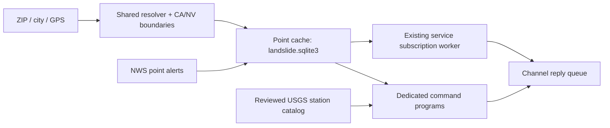

# California and Nevada landslide information and alert monitoring

Three dedicated commands provide NWS alerts mentioning landslide hazards,
temporary alert subscriptions, and the nearest eligible USGS monitoring station.
Location queries support California and Nevada. Station observations are research
information; they are not used to generate warning levels or predict slope failure.

## Commands and location formats

| Command | Example | Result |
| --- | --- | --- |
| `!slidewarn` | `!slidewarn 91107` | Applicable actual NWS alerts mentioning landslides, debris flows, mudslides, or mud flows. Includes watches and warnings under their original product names. |
| `!slidealarm` | `!slidealarm on Pasadena` | Four-hour subscription after a successful baseline lookup; initial reply includes current matching alerts. |
| `!slidealarm` | `!slidealarm status` / `!slidealarm off` | Remaining subscription time/data availability, or immediate cancellation for that sender and channel. |
| `!slideinfo` | `!slideinfo 34.15, -118.14` | Nearest eligible station, distance, monitored variables, published graph interval, catalog date, and source link. |

Each location-taking command accepts the same parser and geocoder as the flood
functions: five-digit US ZIP (optional ZIP+4 suffix), city with optional state,
or decimal GPS coordinates with latitude first and longitude second. A comma
between coordinates is optional. Bare cities default to California; append `NV` or `Nevada` for Nevada cities. Coordinates
do not require geocoding; place names and ZIP codes require Internet access.
Resolved places represent one point, not an entire city or ZIP area.

```text
!slidewarn Pasadena
!slidewarn Pasadena CA
!slidewarn 91107
!slidewarn Reno NV
!slidewarn 89501
!slideinfo Las Vegas Nevada
!slideinfo 39.25,-119.96
!slidewarn 34.15 -118.14
!slidealarm on 34.15,-118.14
!slidealarm status
!slidealarm off
!slideinfo near Castro Valley
```

The bundled California and Nevada polygons check every resolved location,
including GPS and ZIP results. Coverage includes both sides of Lake Tahoe, Reno,
Carson City, Las Vegas, Elko, and other Nevada locations. Points outside these
two states are rejected. Exact polygon boundary points are accepted. Ordinary channel assignment, sender cooldown, tagged replies, and
radio transmission limits apply. Each command permits up to 12 reply parts.

## Alert interpretation

The source is the [NWS alerts API](https://www.weather.gov/documentation/services-web-api).
A lookup verifies `/points/{latitude},{longitude}` coverage before requesting
`/alerts/active?point=...&status=actual`. NWS performs geographic applicability
matching, including alerts whose CAP geometry is null. The original alert area
and geometry are retained in JSON; alert polygons are not replaced with fire zones.

Headline, description, and instruction fields are checked for explicit hazard
terms. Original event names, issuing offices, issue times, and expiration times
remain visible. A `Flood Watch` or `Flash Flood Warning` is not renamed to an
invented landslide product. Instruction-only and qualified/negated mentions are
labelled `precautionary/qualified mention only`; that label is a text-classification
description, not a warning level. Classification is rule-based and can miss unusual
wording. An alert for heavy rain without these terms remains outside this command.

Actual, effective, unexpired alerts are eligible. Tests/exercises and future-effective
messages are excluded. An already-effective watch remains visible before its onset.
CAP update references supersede earlier records. Malformed or incomplete responses
produce unavailable status, never an absence claim. Successful empty responses say
that no matching NWS alerts were found and explicitly state that this is not an all-clear.
This interface does not provide comprehensive landslide detection or local evacuation orders.

Radio replies contain bounded source-text excerpts and links. `--json` preserves
the complete fetched CAP collection, matched records, original instructions,
geometry, references, source URL, coverage zone, and acquisition time. Display
times follow the existing `responder.timezone`; source times retain their offsets.

## Subscription lifecycle and storage



The existing service owns subscription scheduling; no additional operating-system
service is installed. Only `!slidealarm on LOCATION` enrolls or renews. Acceptance
replaces the previous location and resets expiry. The new subscription stays
disabled until a fresh baseline succeeds, and checks begin only after its
acknowledgment is sent. A failed replacement leaves no active subscription.
`off` invalidates pending enrollment and queued changes immediately. `status`
does not renew. Repeated or delayed control messages cannot replace a newer revision.

Subsequent checks use the enrolled GPS point, avoiding repeated geocoding and
location drift. Changes include new/meaningfully updated alerts, explicit
cancellations when provided, expiry, and disappearance from a successful current
feed. Disappearance is labelled as such, never treated as an all-clear. A new
message identifier alone does not trigger a duplicate update when CAP references
link it to unchanged content.

Subscriptions persist in `runtime/bridge.sqlite3`, keyed by stable channel ID and
sender, with channel identity and expiry guards. Valid subscriptions resume after
restart; removed assignments, changed channel identities, and expired subscriptions
cannot send. A lookup outage retains the previous baseline and emits one outage
notice, followed by one recovery notice when data becomes available again.
Baseline changes are committed before sending, following the existing policy
against replaying messages with uncertain delivery. Radio delivery is not guaranteed.

`runtime/landslide.sqlite3` stores complete point snapshots, fetch/attempt times,
and errors. Lookups and service subscription checks refresh due points on demand;
there is no statewide background download when no location is requested. Multiple
subscribers and commands can reuse one fresh point snapshot. Expiration is checked
even within the cache interval. Failed refreshes preserve previous data for
diagnosis but never return it as current. A bounded writer lock prevents concurrent
refreshes; a busy cache reports unavailable and can be retried. Unused points are
pruned after seven days and the cache retains at most 1,000 points. Runtime files
are excluded from release archives.

| `responder.landslide` setting | Default | Limit / meaning |
| --- | --- | --- |
| `enabled` | `true` | Enable landslide lookups and subscriptions. |
| `cache_seconds` | `300` | 60-900 seconds; reuse/retry interval per point. |
| `subscription_interval` | `300` | 60-900 seconds between subscription checks. |
| `subscription_hours` | `4` | Positive duration, at most 24 hours. |
| `max_alerts` | `3` | 1-10 matched alerts in a radio lookup; JSON retains all. |

Each lookup has a 45-second process budget; individual NWS requests have a
12-second timeout and 4 MiB response limit. Polling plus radio queues can delay
notifications. Full alert text and normal official warning channels remain necessary.

## USGS station catalog and provenance

The bundled catalog contains the 13 California entries on the
[USGS Landslide Monitoring Stations page](https://www.usgs.gov/programs/landslide-hazards/science/landslide-monitoring-stations),
reviewed on October 20, 2026. Twelve are eligible for nearest-station ranking;
Highway 50 is marked discontinued. Listed status does not establish working telemetry.
The reviewed index lists no Nevada stations. Nevada queries therefore rank the
same California catalog, explicitly identified in the reply; this does not
establish local sensor or warning coverage. The catalog includes BALT1-4, Chips, Chambers, Maria Ygnacio, Las Lomas,
Arroyo Seco, Dunsmore, Pasadena Glen, Castro Peak, and Highway 50.

Coordinates come from the official USGS study-area GeoJSON. Its Castro Peak
record duplicates Arroyo Seco's coordinate. Castro Peak instead uses its
[individual USGS station map](https://www.usgs.gov/sidebar-map/node/349227),
which locates it near Malibu. Each station retains its coordinate-source URL.
Distances use WGS84 geodesics and do not define station coverage.

Station pages publish 30-minute graph updates for BALT1-4 and 60-minute graph
updates for the included postfire stations. `!slideinfo` describes the published
interval, not the age of the latest measurement. No numeric readings, graph-image
extraction, station-derived warnings, statewide event reports, or event statistics
are included in this release. USGS measurements are preliminary and subject to revision.

`data/landslide/manifest.json` records source URLs, selection rules, review date,
notes, and SHA-256 hashes for the station catalog and California/Nevada reference polygons.
The boundaries come from the public US State and County ArcGIS layer using
`STUSPS='CA'` and `STUSPS='NV'`. Both packages include byte-identical references and verify their
hashes before use. Reference updates require review, paired file replacement,
updated hashes/date, and the tests below; runtime lookups do not scrape USGS pages.

## Standalone operation, upgrades, and verification

```text
python scripts/slidewarn.py 91107
python scripts/slidewarn.py --json 34.15 -118.14
python scripts/slideinfo.py --json Castro Valley
python scripts/slidealarm.py on Pasadena
python scripts/slidealarm.py --snapshot on 34.15 -118.14
```

Standalone alarm execution performs a lookup only and explicitly states that it
creates no subscription. Standalone `status`/`off` require the running service and
do not alter its subscriptions. `--snapshot` supplies structured data to the service;
it does not start a worker. `MESHCORE_RUNTIME_DIR` can select a separate writable
cache directory for diagnostics. Installed processes receive saved landslide
settings through `MESHCORE_LANDSLIDE_SETTINGS`.

Upgrades preserve existing configuration and channel assignments. New commands
are initially unassigned when upgrading an existing channel registry; assign the
three commands to the desired channel IDs, validate configuration, and restart.
Fresh installations assign them to the shipped default channel. Existing flood
and fire subscriptions retain their separate behavior and state.

Run in each platform package:

```text
python -m unittest discover -s tests -p test_landslide.py
python -m unittest discover -s tests -p test_command_programs.py
python -m unittest discover -s tests
```

Tests use synthetic CAP fixtures for lifecycle and failure cases, the bundled
boundary/catalog for geographic checks, and service callbacks for subscription
and queue behavior. Host tests do not establish native Linux service operation,
live warning issuance, physical radio delivery, or continuous provider availability.
