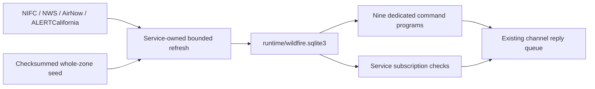

# California wildfire information

Nine dedicated programs provide fire-weather zones, reported incidents,
mapped perimeters, containment, forecasts, fire-weather alerts, supplementary
context, point smoke/fuel-danger lookups, and temporary monitoring. The service collects public upstream data
identified through the [Enterprise Geospatial Portal](https://egp.wildfire.gov/maps).
Replies use local snapshots, with acquisition age and observation times.

## Radio commands

[Every tagged command/category/control example](RESPONSE_EXAMPLES.md) and
[response priorities and conditional fields](RESPONSE_FORMATTING.md) describe the
concise radio presentation. Local JSON retains full supported source records.

| Command | Example | Result |
| --- | --- | --- |
| `!firezone` | `!firezone 39.25 -119.96` | Complete official fire-weather zone, name, forecast office, interstate coverage, and current fire-weather warning/watch status. |
| `!fires` | `!fires CAZ272` | Incidents whose origin or latest mapped perimeter intersects the zone. |
| `!fires` proximity | `!fires near Truckee within 25` | Incidents within the specified miles of the resolved point or perimeter. |
| `!fire` | `!fire INCIDENT-ID` | Exact incident identifier or unambiguous name; containment provenance and perimeter observation time. |
| `!firewx` | `!firewx CAZ272` | NWS zone fire-weather forecast, humidity, winds, thunderstorm/wetting-rain fields when published, and active fire-weather alerts. |
| `!firewarn` | `!firewarn CAZ272` | Active Red Flag Warnings and Fire Weather Watches. |
| `!firedata` | `!firedata raws CAZ272` | Supporting observations or mapped features intersecting the zone. |
| `!firealarm` | `!firealarm on CAZ272` | Temporary service-managed monitoring, after a fresh baseline is available. |
| `!firealarm` control | `!firealarm status` / `!firealarm off` | Inspect or cancel that sender's subscription on that channel. |
| `!smoke` | `!smoke 96150` | Point smoke coverage, nearest mapped edge when outside, and nearby air quality. |
| `!firedanger` | `!firedanger Reno NV` | Nearest eligible ERC station, historical percentile, trend and warning context. |

Examples: `!firezone 39.25, -119.96`, `!firezone 96161`, `!firezone Truckee`,
and `!firezone Incline Village NV`. Each returns zone identification and the
current cached Red Flag Warning / Fire Weather Watch status. Missing or stale
alert data is identified rather than interpreted as clear conditions.

Locations accept latitude/longitude, US ZIP codes, and city/state using the
existing location resolver. Bare cities default to California. A resolved
place is one point, not the entire municipality. Zone identifiers are accepted
case-insensitively; names of zones are not aliases. Locations outside the
configured California-associated zone collection are rejected by zone-based
commands. `!smoke` and `!firedanger` use point-based searches instead.

Every lookup returns one concise tagged message. No paging or details route is
available. Alert/uncertainty text precedes optional fields. Source records and
full attributes remain available through standalone JSON output. See the
[manual response review inventory](RESPONSE_FORMATTING.md).

`!fires near` presents the selected incident's name, containment and map distance
instead of its identifier. The distance is the minimum to available mapped
perimeter or origin geometry, not a travel distance. Full identifiers remain
in JSON results and continue to work with `!fire INCIDENT-ID`.

## Geography and interpretation

The reference seed contains 186 complete NWS fire-weather polygons retrieved on
October 20, 2026. Selection uses at least one hectare of intersection with the
California state reference boundary, rejecting tiny boundary slivers. Selected
polygons are not clipped at the state line. CAZ272 includes the Nevada side of
Lake Tahoe; NVZ420 is included because it intersects California. Exact
boundary points can belong to multiple zones and all matches are retained.
The source polygon version and checksum are recorded in `data/wildfire/manifest.json`.
Full source checkouts retain matching seed copies in both platform folders.
Service installers and standalone service ZIPs use the independent wildfire
data package; install it before relying on zone-based lookups. See
[dataset installation](../docs/DATA_PACKAGES.md).

These are **NWS fire-weather forecast zones**. They are not evacuation zones,
CAL FIRE administrative units, dispatch areas, predictive service areas, or
fire-hazard severity classifications. Those geographies cannot be substituted
without an explicit crosswalk.

Incident origins and mapped perimeters are separate observations. A point-only
incident remains visible without an invented perimeter. Multiple perimeter
uploads are reduced to the latest published polygon timestamp, retaining
records tied at that time. A fire can intersect several zones. Complex and
component records can overlap; incident acreage is not summed across them.

Containment is the reported percentage for the incident. It does not identify
which edge of a perimeter is contained and does not imply extinguishment.
Null or invalid containment remains “not reported.” Incident attributes use
EGP summary precedence, with field-level WFIGS fallback and source timestamps
retained in JSON. Different fields can therefore refer to different reports.
Perimeter uploads without an IRWIN identifier are retained for export, marked
`join_status=unlinked`, and excluded from incident joins.

Current-feed membership is not a complete inventory of every burning fire.
WFIGS current records have age/status eligibility rules, and EGP uses its own
operational classifications. The union of both feeds is used, excluding
prescribed-fire classifications. A disappearing record is reported as
“no longer listed; status unconfirmed.” An explicit `!fire` lookup can return
the last locally retained observation, clearly labelled historical, for up
to the configured history retention. Historical records never populate
`!fires`.

Thermal detections are satellite observations, not incident confirmations or
perimeters. AQI and smoke products measure or forecast different quantities. Negative AQI
forecast sentinels are unavailable values, even if a category string says Good.
Significant-fire-potential replies preserve provider dryness/validity codes and
flags; these are not translated into a locally invented risk score.
RAWS readings are station observations, not zone-wide forecasts. Cameras
provide source links, not automated confirmation of a fire.

## Sources and supplementary categories

Source URLs and query filters are maintained in
[scripts/wildfire_sources.py](scripts/wildfire_sources.py). No EGP browser
scraping, credentials, or commercial API keys are required by this feature.

| Data | Upstream collection | Use |
| --- | --- | --- |
| Zones | [NWS reference fire-weather zones, layer 9](https://mapservices.weather.noaa.gov/static/rest/services/nws_reference_maps/nws_reference_map/MapServer/9) | Whole-zone geometry, office identifiers and source dates. |
| Incident summary | [EGP Active Incidents public view](https://services3.arcgis.com/T4QMspbfLg3qTGWY/arcgis/rest/services/EGP_Active_Incidents_Prod_Public_View/FeatureServer/0) | Name, acreage, containment, classification and IRWIN ID. |
| Incident origins | [WFIGS Current Incident Locations](https://services3.arcgis.com/T4QMspbfLg3qTGWY/arcgis/rest/services/WFIGS_Incident_Locations_Current/FeatureServer/0) | Incident identity, origin and fallback attributes. |
| Perimeters | [WFIGS Year-to-date Interagency Perimeters](https://services3.arcgis.com/T4QMspbfLg3qTGWY/arcgis/rest/services/WFIGS_Interagency_Perimeters_YearToDate/FeatureServer/0) | Latest available mapping matched by normalized IRWIN GUID. |
| Forecasts | [NWS API](https://www.weather.gov/documentation/services-web-api) FWF products by forecast office | Zone-specific forecast text and issuance time; compressed UGC headers are expanded. |
| Fire alerts | NWS active CAP alerts across CA, NV, OR and AZ | Actual, effective, unexpired Red Flag Warnings and Fire Weather Watches; UGC matching also works with null geometry. |
| `raws` | NIFC PublicView_RAWS | Station humidity, winds, gusts, observation time; additional attributes in JSON. |
| `aqi` | AirNow Current Monitor Data | PM2.5 AQI and valid time; missing/negative sentinel measurements remain unknown. |
| `smoke` | NOAA NDGD SmokeForecast | Smoke classification polygons and validity interval. |
| `viirs`, `modis` | NIFC heat detections | Last 24 hours; nominal/high VIIRS or MODIS confidence at least 70. |
| `cameras` | ALERTCalifornia camera feed | Active camera records, online flag and camera link. |
| `aqi_today`, `aqi_tomorrow` | AirNow National AQI Forecast | Forecast reporting areas and original attributes. |
| `spc` | [SPC fire-weather outlook map service](https://mapservices.weather.noaa.gov/vector/rest/services/fire_weather/SPC_firewx/MapServer) | All published leaf layers, preserving outlook day/type. |
| `potential` | [National 7-Day Significant Fire Potential](https://fsapps.nwcg.gov/psp/arcgis/rest/services/npsg/outlooks_forecast/MapServer) | Days 1–7, preserving layer/day and original categories. |
| `treatments` | NIFC Integrated Interagency Fuels Treatments | Mapped treatment context; not a current incident feed. |
| `history` | NIFC Interagency Fire Perimeter History, all years | Historical burn context; distinct from the cache's recent observation history. |

The first six supplementary categories (`raws`, `aqi`, `smoke`, `viirs`,
`modis`, `cameras`) refresh by default. Enable the remaining categories in
`responder.wildfire.context_sources`, or fetch one explicitly with
`wildfire_refresh.py --source CATEGORY`. An uninitialized category reports
unavailable data; it does not start an HTTP download from a radio request.
Large historical/treatment layers can span multiple bounded passes. Completed
batches resume from `runtime/wildfire-downloads` for up to six hours; only a
complete collection replaces the cache. Repeat an explicit `--source` refresh
to continue immediately, or allow the configured service interval to retry.
Staging files are excluded from distributions and removed after completion;
expired staged files are cleaned during subsequent reference downloads.

## Refresh and storage



The existing service owns the refresh worker; no extra operating-system service
is installed. It starts when wildfire is enabled and a wildfire command has a
channel assignment. Each child process has a 240-second network budget and a
300-second service timeout. A database lease prevents concurrent refresh
writers. Each pass handles the oldest attempted sources first, then sleeps
60 seconds; per-source due intervals still apply.

ArcGIS downloads first enumerate object IDs, then fetch and check complete
batches. Duplicate, missing or truncated batches fail the source refresh.
Geometry is checked in WGS84 and repaired when possible, retaining a repair
flag. Each source replaces its snapshot atomically. A failure records an error
and leaves its previous data intact. Sources refresh independently; a report
is not a simultaneous observation of all providers.

The cache includes source URLs, fetch/attempt times, errors, digests, original
attributes, geometry, a spatial index, and changed-snapshot history. Runtime
databases and live data are excluded from release archives. The versioned
zone seed is included in both standalone ZIPs and complete installers.

| `responder.wildfire` setting | Default |
| --- | --- |
| `enabled` | `true` |
| `incident_interval`, `alert_interval` | 300 seconds |
| `perimeter_interval`, `weather_interval` | 900 seconds |
| `context_interval` | 1,800 seconds |
| `boundary_interval` | 86,400 seconds |
| `stale_after` | 3,600 seconds for dynamic source acquisition |
| `history_days` | 7; maximum 30 |
| `subscription_hours`, `subscription_interval` | 4 hours, 300 seconds |
| `containment_change`, `acreage_change` | 10 percentage points, 100 acres |
| `max_results`, `maximum_radius_miles` | 3 records, 100 miles |
| `context_sources` | `raws`, `aqi`, `smoke`, `viirs`, `modis`, `cameras` |

Intervals must be at least 60 seconds. The maximum supported radius is
200 miles and subscription duration is capped at 24 hours. Zone acquisition
becomes stale after twice its boundary interval. Acquisition freshness does
not guarantee a recent observation: field, perimeter and forecast timestamps
must also be interpreted. Provider delays, missing reports and source outages
remain visible limitations.

## Temporary monitoring

One subscription belongs to a sender/channel pair. `on` replaces its location,
resolves and stores fixed zone IDs, and starts the configured lifetime after
request acceptance. A fresh complete baseline of incident, perimeter, zone
and alert sources is required before enrollment is acknowledged. Monitoring
becomes ready only after the acknowledgment has been transmitted.

Changes include newly listed incidents, records leaving current feeds,
containment changes of at least the configured percentage-point threshold,
reported completion at 100%, acreage changes of at least the configured
threshold, perimeter availability, and new/updated/expired fire-weather
alerts. Missing-to-known measurements are also reported. Small changes
accumulate against the last notified baseline. Geometry-only revisions,
forecast wording, and supplementary observations do not trigger alarms.

Unchanged checks are silent. An outage preserves the baseline and produces
one notice per failure episode; recovery is also reported. An alert removal
is reported only after a successful, fresh alert acquisition. Cancellation,
expiry, newer revisions, channel identity changes and removed assignments
invalidate pending notifications, including messages waiting for a send slot.
Subscription state survives ordinary service restarts. Possibly transmitted
messages are not blindly replayed after delivery failure.

Sender labels come from received channel text; subscriptions are not a
separate authenticated-user system. These notifications are situational
information and do not issue evacuation instructions or guarantee delivery.

## Standalone use and exports

Run from the platform package directory with its installed dependencies:

```sh
python scripts/wildfire_refresh.py
python scripts/wildfire_refresh.py --status
python scripts/firezone.py CAZ272
python scripts/fires.py --json CAZ272
python scripts/firewx.py --json CAZ272
python scripts/firealarm.py on CAZ272
python scripts/wildfire_refresh.py --source spc --force
python scripts/firedata.py --json spc CAZ272
python scripts/wildfire_refresh.py --export zones > zones.geojson
python scripts/wildfire_refresh.py --export perimeters > perimeters.geojson
```

`--export perimeters` exports the cached regional year-to-date source, including
unlinked and older uploads; command JSON selects the latest joined perimeter
for each incident. All GeoJSON uses longitude/latitude WGS84. Retain the
source-status output alongside exports for acquisition provenance.

All command programs support `--db PATH`, `--json`, and an explicit `--refresh`.
`firealarm.py --monitor on ZONE` emits a compact, freshness-checked JSON
snapshot for the service without enrolling a subscription. The refresh utility also supports repeated `--source`, `--force`, `--status`,
and `--export SOURCE`. Standalone `firealarm.py` produces a snapshot and
explicitly states that no subscription was created. Status/off require the
running service. None of these programs start a persistent scheduler.

The service passes its runtime directory and validated settings to children.
For administrator execution against installed state, set `MESHCORE_RUNTIME_DIR`
to the service runtime directory, and `MESHCORE_WILDFIRE_SETTINGS` to a JSON
object when external settings must override the packaged config. `--db`
overrides the database location. Use the service account's write permissions
for refreshes; do not share a writable cache with untrusted users.

To rebuild the maintained boundary dataset from the repository root:

```sh
python tools/prepare_wildfire_data.py
```

This downloads both reference boundaries, validates the selection, records a
checksum and retrieval time, and mirrors the seed into both packages. Review
changes to the zone list before packaging. Upstream boundary revisions can
change membership; future live refreshes use the same selection rule.

## Implementation reference

[All wildfire, smoke, fuel-danger, refresh, cache, and subscription functions](WILDFIRE_FUNCTION_REFERENCE.md)
are documented separately from radio usage.

## Deployment and verification

Fresh configuration registers all nine dedicated scripts on the default
channel. Upgrades preserve existing command assignments and add missing
commands with empty assignment lists when a channel registry already exists.
Assign the desired commands through the existing channel configuration tools,
review `responder.wildfire`, then restart the service. Existing configuration
values remain operator-managed; installation does not replace them with new
defaults.

Offline tests cover whole-zone interstate selection, batch completeness,
atomic replacement, writer exclusion, schema rejection, incident joins,
unknown containment, historical labeling, FWF headers, null-geometry alerts,
subscription acknowledgment/expiry/cancellation, outages, and change thresholds.
Live-provider checks exercise a point in Nevada within CAZ272 and source
downloads. Those checks do not establish native Linux execution, installed
service lifecycle, radio transmission, or recipient delivery.

## Point smoke and fuel danger

`!smoke LOCATION` and `!firedanger LOCATION` accept decimal latitude/longitude
(comma or space separated), US ZIP/ZIP+4, and city/state. Bare cities default
to California. City and ZIP inputs resolve to one representative point, not
the entire postal or municipal area. Coordinates provide the most specific
location. These commands do not accept zone IDs or paging and do not require
a match to the California-associated zone seed.

```text
!smoke 96150
!smoke South Lake Tahoe CA
!smoke 39.25, -119.96
!firedanger Reno NV
!firedanger 96150
!firedanger 39.25 -119.96
```

### Smoke response

The response body starts with `Smoke:`. It has no city/ZIP header, `Monitor:`
line, or `PM10:` line. Normal sender tagging and the single-message limit still
apply. The following values illustrate formatting, not current conditions:

```text
Smoke: medium mapped plume; surface exposure may differ. | PM2.5 AQI 118 Unhealthy for Sensitive Groups | Oct 21 11:00 PDT
```

Local JSON includes ozone when a fresh nearby measurement is available. Concentration
units and AQI are supplied by AirNow; the program does not calculate an AQI
from an instantaneous concentration. Different pollutants can come from
different stations. PM10, station identity, distances, source status, and
the resolved point remain available through `smoke.py --json`.

NOAA HMS polygons describe satellite-visible smoke and qualitative density.
They are not surface concentration measurements. Exact polygon edges count
as inside; polygon holes count as outside. Overlapping plumes use the highest
reported density. Outside a plume, structured output retains the nearest edge,
approximate straight-line distance, direction, and observation time within
`maximum_radius_miles`. Full source polygons are retained across state lines.
A search with no nearby polygon reports the search limit and incomplete
satellite detection; it does not establish clean air or predict smoke arrival.

HMS files are downloaded for the current UTC date, with a one-day fallback
only for HTTP 404. Plumes older than `smoke_max_age` are excluded even when
the file was just downloaded. Nighttime, clouds, incomplete detection, old
observations, and failed refreshes can leave current smoke coverage unknown.
AirNow measurements are evaluated independently and can remain available.

The program does not infer a named source fire from proximity or plume
overlap. HMS geometry has no reliable incident identifier; consequently the
structured output records that the origin is not established; this field is
optional in the radio reply. Numerical smoke transport,
trajectory-based attribution, and named-fire attribution from verified
advisories are not implemented. The existing `!firedata smoke` remains a
separate zone-level forecast product. PM and AQI do not measure all toxic
constituents of a smoke mixture or establish that smoke is exclusively wildfire-derived.

### Fire-danger response

The public NIFC NFDRS service joins station locations to daily ERC and Burning
Index summaries by station ID. It supplies historical percentiles and observed
and forecast trends from FEMS. The nearest processing-enabled station with a
nonnegative ERC and sufficiently recent publication is selected within
`maximum_radius_miles`. The radio reply prioritizes an official warning or
unknown local danger rating and the qualification that ERC excludes wind. ERC,
percentile, publication time and station name are optional fields. Structured
JSON retains distance, model, trend, available Burning Index, forecast values
and elevation with the full supported source record.

The public product uses **NFDRS2016 fuel model Y (forest), 2005-2022 full-year
daily maxima** for its reference distribution. It is a regional indicator,
not a measurement of the vegetation at the requested point. This model can
be unrepresentative of grassland, shrubland, different elevations, or terrain
across a mountain divide. The program does not automatically substitute a
different fuel model or an agency-designated representative station.

Percentile interpretation is descriptive and is not an official danger class:

| ERC percentile | Response assessment |
| --- | --- |
| Below 50 | Fuel-energy potential below the historical median; wind-driven fire remains possible |
| 50 to below 90 | Fuel-energy potential at or above the historical median |
| 90 to below 97 | Unusually high fuel-energy potential relative to local history |
| 97 through 100 | Exceptionally high fuel-energy potential relative to local history |
| Missing/invalid | Severity unclassified; matching climatology unavailable |

An ERC percentile is not a probability of ignition. Raw ERC values are never
assigned universal Low/Moderate/High/Extreme thresholds. The report explicitly
states that an official local danger rating is unavailable. The public summary
is published at approximately 03:00 Mountain Time; its ERC is the most recent
daily maximum, not an instantaneous observation. Publication time is labeled
accordingly. Trends are provider-defined comparisons with two days earlier.

Nearby RAWS wind, gust, and humidity observations are retained independently
in structured output and the corresponding `!firedata raws` lookup.
Fire-weather warnings are matched to the resolved point's known NWS fire
zones, independently of whether ERC exists. Missing/stale zone or alert data
produce an unknown warning status. ERC excludes wind; the command does not
combine components into an invented composite score or suppress warnings
because ERC is low.

### Optional FEMS fuel moisture

Detailed modeled 1-, 10-, 100-, and 1000-hour dead fuel moisture and live
herbaceous/woody fuel moisture require optional authenticated FEMS access.
Percentages are source model outputs, not direct samples at the query point.
They use their own timestamps and retain the source quality code and NFDR
type. Source quality codes are not interpreted as a quality approval; the
response labels their QC as unverified. These values do not change the public percentile assessment. Unavailable
or stale detailed values remain unknown.

1. Obtain a FEMS account with the API or Admin role and generate an API key.
2. Set `FEMS_USERNAME` and `FEMS_API_KEY` in the service account environment.
   Do not place credentials in command arguments, packaged files, or radio messages.
3. Add up to 20 station ID strings to `responder.wildfire.fems_station_ids`.
   Use station IDs from the provider catalog, not ArcGIS object IDs.
4. Restart the service to inherit the environment and settings.
5. Inspect `wildfire_refresh.py --source fems --force` and `--status`.

Only configured stations are downloaded, using model Y and a bounded
two-day request with complete pagination. Detailed values are attached only
when the selected public station matches and a recent FEMS value exists.
The default list is empty, so installations need no FEMS credentials for
public ERC/BI reporting. Credential errors affect only the optional source.
Authenticated retrieval requires deployment validation with an authorized
account; offline tests cannot establish account access or live schema compatibility.

### Sources, settings, and operation

| Source | Access and role |
| --- | --- |
| [NOAA HMS](https://www.ospo.noaa.gov/products/land/hms.html) | Full dated KML smoke polygons; public, no key |
| [AirNow monitor feed](https://services.arcgis.com/cJ9YHowT8TU7DUyn/arcgis/rest/services/Air%20Now%20Current%20Monitor%20Data%20Public/FeatureServer/0) | Existing regional cached PM2.5, PM10, ozone measurements and AQI; public |
| [NIFC NFDRS service](https://services3.arcgis.com/T4QMspbfLg3qTGWY/arcgis/rest/services/NFDRS_ERC_and_BI_Percentiles_and_Trends/FeatureServer) | National station layer 0 joined to summary table 4; public |
| [NFDRS service metadata](https://www.arcgis.com/home/item.html?id=db8921ba6baa4444bd867aab3e69260e) | Fuel model, climatology, update schedule and trend definitions |
| [FEMS API guidance](https://www.wildfire.gov/page/fems-api) | Optional read-only GraphQL API; API role and credentials required |
| [Forest Service NFDRS explanation](https://research.fs.usda.gov/firelab/projects/firedangerrating) | Fuel moisture and fire-danger component interpretation |

New `responder.wildfire` settings merge into older configuration defaults:

| Setting | Default | Meaning |
| --- | --- | --- |
| `smoke_interval` | 1800 seconds | HMS refresh interval |
| `danger_interval` | 3600 seconds | Public NFDRS and optional FEMS polling interval; public summaries update daily |
| `smoke_max_age` | 21600 seconds | Maximum plume observation age (6 hours) |
| `air_quality_max_age` | 10800 seconds | Maximum AirNow observation age; also recent RAWS and FEMS detail age |
| `danger_max_age` | 129600 seconds | Maximum daily NFDRS publication age (36 hours) |
| `monitor_radius_miles` | 50 miles | Maximum distance to a cached air-quality or weather station; hard cap 200 |
| `fems_station_ids` | `[]` | Optional station list, up to 20 unique numeric strings |

`maximum_radius_miles` also bounds smoke-edge and ERC station searches.
`stale_after` limits the HMS cache age; observation age is checked separately.
AQI refresh remains controlled by `context_sources` and `context_interval`.
HMS and NFDRS refresh by default in the existing wildfire worker; optional
FEMS refresh starts when its station list is nonempty. AirNow/RAWS coverage
remains the configured California-associated regional download envelope,
so outside that envelope nearby monitoring data may be unavailable even
though national NFDRS or full HMS data are available.

```sh
python scripts/wildfire_refresh.py --source hms --source nfdrs --source aqi --force
python scripts/smoke.py --json 96150
python scripts/firedanger.py --json "Reno NV"
python scripts/smoke.py --refresh 39.25 -119.96
python scripts/firedanger.py --refresh 39.25 -119.96
python scripts/wildfire_refresh.py --export hms
python scripts/wildfire_refresh.py --export nfdrs
```

Both commands support `--db PATH`. They are standalone lookups and never
create subscriptions. Downloaded datasets remain in the runtime cache and
are excluded from release packages. `test_fire_environment.py` covers
response omissions, holes/edges, distance limits, source timestamps,
missing measurements, station selection, percentiles, independent warnings,
KML validation, FEMS pagination/credentials, and all location forms.
